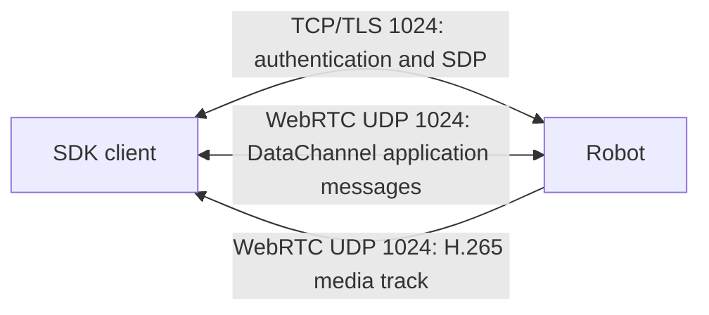
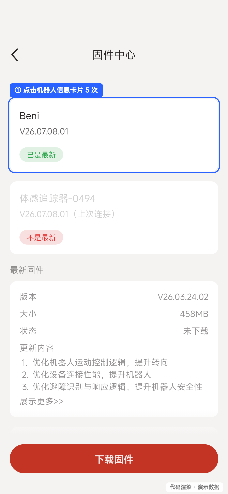
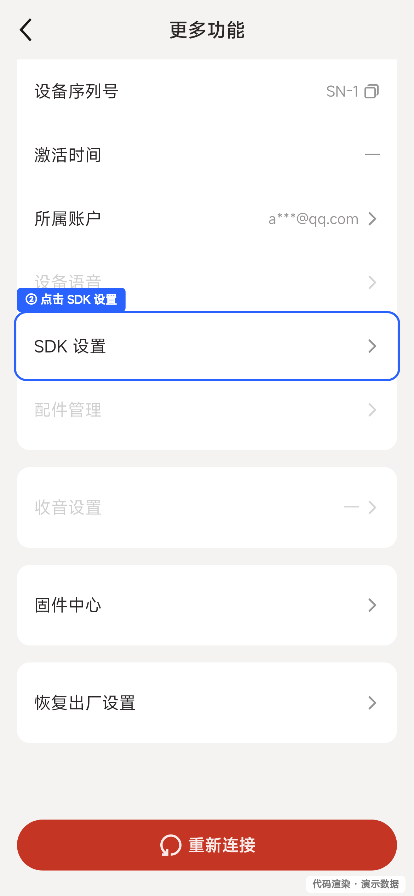
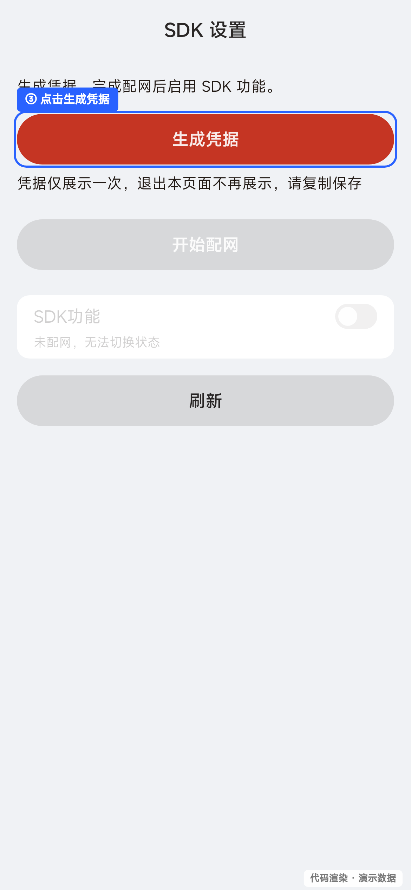
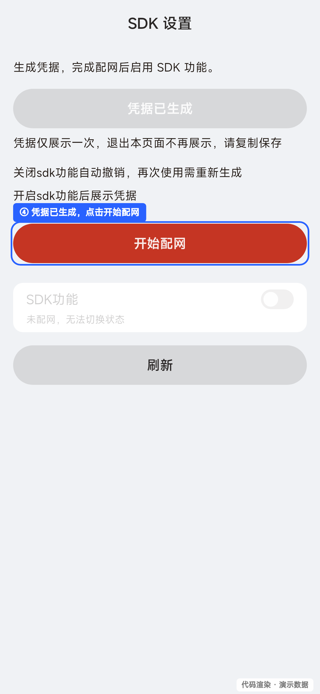
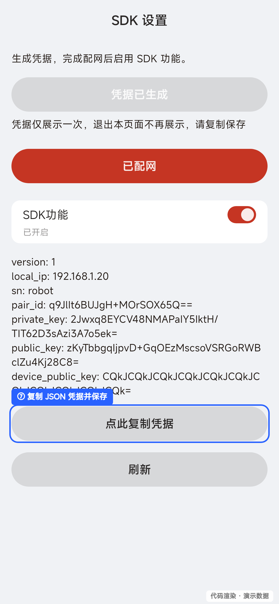
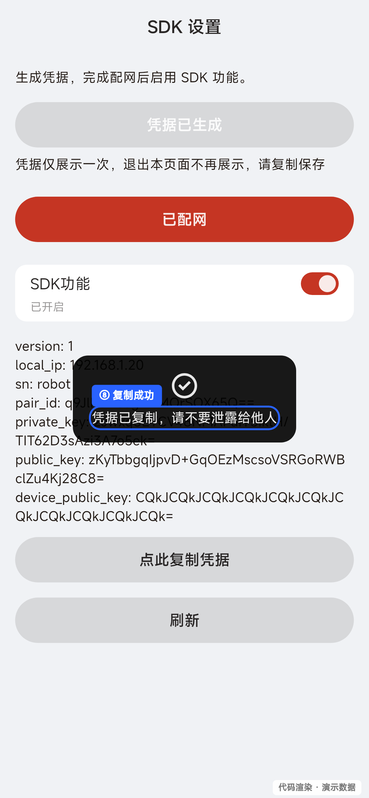
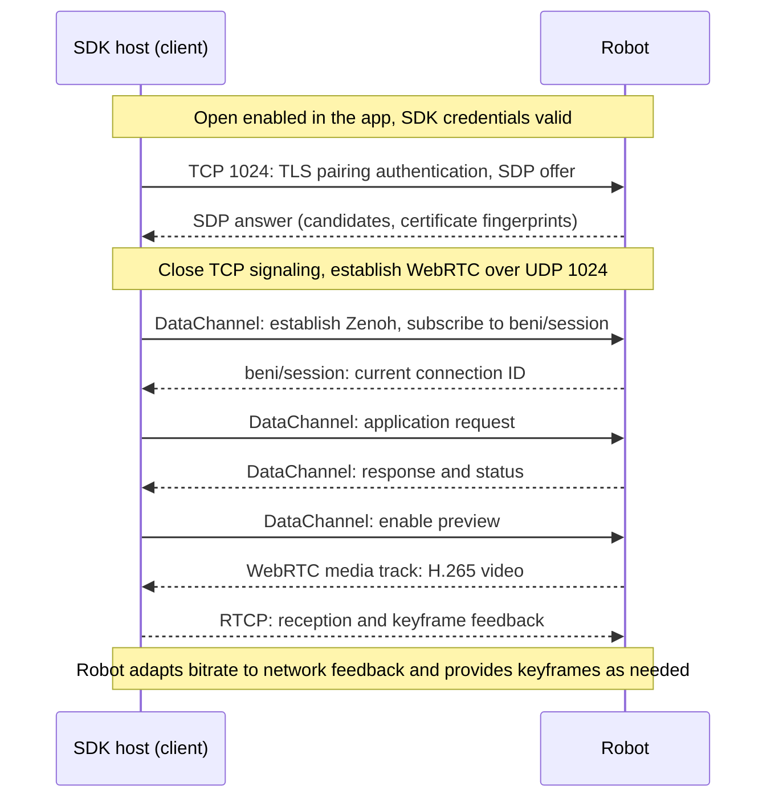

<a id="Htc0dF9pIokLuSxmCfpcUzB3npg"></a>

# MONDO SDK User Guide

[Chinese version](<MONDO SDK使用简介.md>)

App screenshots show the Chinese UI. The captions and instructions below explain the corresponding steps in English.

<a id="JamAd6aryoknClxBacWcPwJ2nfb"></a>

## 1 Communication workflow

<a id="doxcnmkpJIsqjTa0RszPkPQVKyd"></a>

This document describes the Beni local SDK for Linux/WSL. The SDK host is the computer or other device running your SDK application, referred to below as the client.

<a id="MM84dtvFuoSRqixLTOYcITCBnGd"></a>

The client first authenticates pairing credentials and exchanges SDP with the robot over TCP/TLS 1024, then establishes WebRTC. Requests, responses, and status reports use the DataChannel; H.265 video uses a media track. Both share UDP 1024.

<a id="VAZddo82lopadex20IycpF4Un5g"></a>



The TCP signaling connection closes after negotiation. Application messages and video continue over WebRTC.

<a id="YwVOdyy1dojihBx10dfc28BhnNg"></a>

### 1.1 Preparing access

<a id="doxcnAPHeu6qz93RRRyjLbjvlNc"></a>

For first-time access, use the Mondo app: open SDK Settings → generate credentials → configure Wi-Fi → enable the SDK → copy and save credentials. The SDK client and robot must be reachable on the LAN.

<a id="doxcnYDMlp5jgtFblz8L2tJRAkc"></a>

#### Open SDK Settings

1. Sign in to Mondo with the robot owner's account, connect to the target robot, and verify its SN. Keep the local direct connection active while generating credentials.
2. Open **Firmware Center**. Under **Device Information**, tap the robot information card **5 times** to reveal SDK Settings.
3. Return to **Device Management** and open **SDK Settings**.

<a id="doxcnhMCMPA7FAbWs6fpg7jU27g"></a>

Tap the robot information card 5 times again to hide the entry. This changes only the app menu; it does not disable the robot's SDK or revoke credentials.

<a id="doxcnIn7KcQW4uNHlX7MvpkeXef"></a>

<a id="doxcncHbIGgGTQRM0rOhnKAouye"></a>

<a id="doxcn0YSG335W4Q9GwHUrhn0VOd"></a>

**Figure 1: Tap the robot information card 5 times**

<a id="doxcnMSVCkaDlxY8nj6ZTwRH0Uf"></a>



<a id="doxcnrKhXLaTFl7QBHUeGEbC29g"></a>

<a id="doxcnGV3VtuzPi8bK7jtTbzMTye"></a>

**Figure 2: Open SDK Settings**

<a id="doxcnARaoi0jBl4gQsSFlCUajRc"></a>



<a id="doxcnu4orNwBBz2PR2hyHQu5RRd"></a>

#### Generate credentials

1. For initial access, tap **Generate Credentials**. The app generates a separate SDK key pair and pairing identifier.

<a id="doxcnZJCZfDJ4UdDH59Ys0XiVGg"></a>

> <a id="doxcnWVmVt5RmgoRR2OlRXlhBYf"></a>
>
> Credentials are displayed only once. Copy and save them before leaving this page.

<a id="B2MWd1EZBo1TXGxVxIUcES2fnad"></a>

After generation, continue to Wi-Fi setup.

<a id="doxcntauknVTpbGh1ck71v58GMc"></a>

<a id="doxcnF5jpFUzBdn3TAp6EjyxIPh"></a>

<a id="doxcnls3k8mwkimJFQ8Hc7pnoXe"></a>

**Figure 3: Generate credentials**

<a id="doxcnSrW1Ly1fOTAljiMzpR2IRe"></a>



<a id="doxcnchn0182izZ7XyUMSkA1Xxd"></a>

<a id="doxcnlGNUg07bmRsSzHonsMjsGd"></a>

**Figure 4: Credentials generated; configure Wi-Fi**

<a id="doxcnrUFQ0f6h5yXONj0PYtYJVe"></a>



<a id="doxcnCI18Om69zMUbbXNOD3ecgf"></a>

#### Configure Wi-Fi

1. Tap **Configure Wi-Fi** to open **Wi-Fi Management**, then connect the robot to a Wi-Fi network with internet access.
2. Return to SDK Settings when complete.
3. If the robot is online but the displayed state has not updated, tap **Refresh**.

<a id="doxcnIe65sNLbJfBJuIrTc6BxBh"></a>

The SDK switch is unavailable until Wi-Fi connectivity is confirmed. Both enabling and disabling the SDK require the robot to have internet access.

<a id="doxcnFSE2Hs9CWbFMblc8h12JTc"></a>

#### Enable the SDK and copy credentials

1. After generating credentials on this page and confirming Wi-Fi connectivity, turn on **SDK** and wait for the device to confirm **Enabled**.
2. The page displays the generated credentials one field per line as “field name: value”.
3. Tap Copy to obtain the complete JSON. Credentials are shown only during setup; copy the JSON or save a screenshot before leaving SDK Settings.

<a id="doxcnO5jd2xd6EW2vlX8VtryhMf"></a>

The JSON contains sn, pair_id, private_key, public_key, device_public_key, and available local_ip and credential-generation information. If local_ip is empty, refresh. If the address changes, use the robot's current LAN IP and ensure the client can reach it.

<a id="doxcn5712v0TpU5IICD15NnPYFr"></a>

<a id="doxcnb0lZ3QQ775XBKhLA9JIDRZ"></a>

<a id="doxcnYBWYnfvotqDYpBvfgh1u4f"></a>

**Figure 5: Copy and save the JSON credentials**

<a id="doxcnAffQ44TPrmmY79gIwTJMPg"></a>



<a id="doxcnFNg58mK3d0YRMXtMvii0Re"></a>

<a id="doxcn7158B0NoMMruQ4Azt3iExe"></a>

**Figure 6: Copy confirmation**

<a id="doxcnnbH9zWCTZ43d4uIW9rwnOd"></a>



<a id="doxcnxjpbReNE5Xr55iMOJ7xcke"></a>

#### Credential validity and reconnecting

- The app does not persist the newly generated private key. After leaving SDK Settings, reopening the page cannot recover or copy old credentials. Save them promptly.
- The page reflects the robot's actual authorization state. Exiting the app, clearing app data, or hiding the entry does not revoke existing robot authorization.
- Disabling the SDK revokes old credentials and ends existing SDK sessions. Generate new credentials and enable the SDK before using it again.
- If the SDK is enabled but the saved credentials are lost, disable it while the robot is online. After confirming it is disabled, generate new credentials and enable it again.

<a id="doxcnCYMHszpZ6oATSRD6lfr0jg"></a>

### 1.2 Establish a connection

<a id="doxcnjBUPETlavLyFoLfmOtAANf"></a>

Read the SDK credential JSON exported by the app and connect to the robot's current LAN IP. The SDK host must support TLS 1.3 external PSK, WebRTC H.265 reception, and reliable ordered binary DataChannels. The DataChannel transports the Zenoh byte stream.

<a id="doxcn33RDglBT81Y2HxdEsGaZYf"></a>

### 1.3 Communication sequence

<a id="doxcnVXxnD01lyaBf78JhATPe3e"></a>



<a id="doxcnsbVHWx7BpqELaP5SjeVarY"></a>

## 2 WebRTC LAN connection

<a id="doxcn1F0MFwuwia4NpUwMGNzxBd"></a>

Connect to **port 1024** at the robot's current Wi-Fi LAN IPv4 address. Allow both TCP and UDP. The robot accepts one SDK client at a time.

<a id="doxcnqjzat2En27qfTZepDvh6De"></a>

| Content | Connection | Transport |
| --- | --- | --- |
| Authentication and SDP | TCP/TLS 1024 | Pairing-key authentication; SDP exchanged through Zenoh |
| Commands, preview switch, responses, status | WebRTC / UDP 1024 | Zenoh and Protobuf over DataChannel |
| H.265 video | Same WebRTC / UDP 1024 | Media track, RTP/SRTP |
| Network and keyframe feedback | Same WebRTC / UDP 1024 | RTCP |

<a id="doxcnRL9OAiTw0THKID3A5YlQDb"></a>

### 2.1 Pairing authentication and SDP exchange

<a id="doxcnaD2d1pCLqxxzJXBPI4ckUc"></a>

The client derives a shared secret using its SDK private key and the robot's X25519 public key. HKDF-SHA256 uses the 16-byte pair_id as salt and ASCII `Beni LAN TLS 1.3 external PSK v1` as info to derive a 32-byte external PSK. The robot derives the corresponding key using its currently valid SDK pairing credentials.

<a id="doxcnekq3FEMzCU7cQukg1lN0hb"></a>

Both peers authenticate using TLS 1.3 external PSK, identity `Beni-SDK-v1`, and cipher suite `TLS_AES_128_GCM_SHA256`. After verifying that the handshake selected the pairing key, exchange SDP over this TLS connection.

<a id="doxcnjmdLZb8IBCxWJLH3C3K1lf"></a>

Create an H.265 receive track and a DataChannel named `beni`, using reliable, ordered binary messages. Send complete SDP after gathering ICE candidates.

<a id="doxcnbEO8sins5eyFCwNqTv57hD"></a>

```
app/sdk/webrtc/offer       // Client → robot: complete UTF-8 SDP offer
device/sdk/webrtc/answer   // Robot → client: complete UTF-8 SDP answer
encoding: application/octet-stream
```

<a id="doxcnzOQScgBhaVmOd2hm43ymS4"></a>

Subscribe to answer before publishing offer. These two signaling messages require no application-session attachment. SDP includes candidate addresses and certificate fingerprints. Both peers verify DTLS certificates using the authenticated SDP; WebRTC negotiates session keys for video and the DataChannel.

<a id="doxcnyBpORIy4RRGEHU2F2kuZ5f"></a>

The robot provides only Wi-Fi LAN IPv4/UDP 1024 candidates, without public STUN/TURN or ICE TCP. Video and DataChannel use BUNDLE and multiplex RTP/RTCP on the same port.

<a id="doxcnhagonqENjhCEu7M7onheke"></a>

### 2.2 Application session and revocation

<a id="doxcng3IMT2oZAfDvWviXi25dRb"></a>

Once the DataChannel is ready, establish Zenoh and subscribe to `beni/session`. The 17-byte notification contains a random 16-byte connection ID followed by a reserved byte currently set to 0. Include this connection ID in the attachment of application messages sent to the robot.

<a id="doxcnSNdblyiX3JK74OoFQMGi6a"></a>

The robot closes TCP signaling after SDP exchange; WebRTC continues independently. Authorization is checked continuously. Disabling Open, replacing credentials, or clearing authorization ends the associated WebRTC session and invalidates its request associations.

<a id="doxcnEPRxF4MLfKfILY2cF0wX0c"></a>

If a DataChannel is not established within 30 seconds after SDP exchange, the connection ends. After WebRTC ends, authenticate again, exchange SDP, and obtain a new connection ID.

<a id="doxcnyWdSIHmqOfFPGmG9woc9Hg"></a>

## 3 Application messages and subscriptions

<a id="doxcnxy4g3qYK8Dmq9GYzuUy8sc"></a>

### 3.1 Message routing

<a id="doxcns0KxjXqXwYtO2UqkMLtIEZ"></a>

To send a message, use `app` followed by the canonical topic as the key; to receive, use `device` followed by the topic. Messages must comply with current-session authorization, device support, and the exposed direction. Common examples follow.

<a id="doxcn2zgYcu5N5UJpXDf3W06dte"></a>

```
Version query  app/cmd/common/get_version_req → device/cmd/common/get_version_rsp
Manual mode    app/cmd/mission/request → device/cmd/mission/request_ack
Joystick       app/cmd/rc/joystick
Scheduler      device/status/scheduler/status
Preview        app/cmd/vt/sdk_preview_req → device/cmd/vt/sdk_preview_rsp
Video          WebRTC H.265 media track (see 4.3)
```

<a id="doxcn2bYsAiZ4g7IZvZw8outsLb"></a>

### 3.2 Requests and responses

<a id="doxcnnAItU2TFvKtJrsdmFCZsrs"></a>

For declared request/response pairs, use nonzero header.seq_num and match by current session, response key, and original sequence. Responses from other sessions are not visible. Publish one-way messages directly; subscribe by topic for pushed status. APIs include `Client.request()`, `publish()`, `subscribe()`, and `poll()`.

<a id="doxcnUlLqSxcNz4hQIDp2fY2BIh"></a>

### 3.3 Encoding and transmitting application data

<a id="Tp0pdGkIfoH2KqxLRrucb6oCnCh"></a>

#### 3.3.1 Protobuf encoding

<a id="EpbZdUzgVo6t2lxegk3cE3QWncc"></a>

Application messages use Protobuf inside an **Envelope**. `header` contains `seq_num`, the request number used to match responses. `data` contains the application fields.

<a id="doxcnSK7N9ZvHdmTil65GbkAzwf"></a>

```
Application message (Envelope)
├─ header (tag 1): include as specified for requests/responses; RcJoystick must omit the entire header
│  └─ seq_num (tag 1): nonzero uint32 request number when response matching is required
└─ data (tag 2): application content
```

<a id="XViZdxjJ1ov6XYxAeJAcWuvhnRe"></a>

Tags are field numbers and are assigned separately at each nesting level. Even with no application fields, encode `data` as an empty submessage: `12 00`.

<a id="doxcnx5GY5H75K1e1laMOrH9z9Q"></a>

#### 3.3.2 Publishing and receiving

<a id="doxcnp8ZZ3CJKYjnyXpxCP1OVcc"></a>

Serialize Protobuf into the Zenoh sample payload, use encoding `application/protobuf`, and attach the current connection ID. Binary DataChannel messages carry the Zenoh byte stream including its length encoding. A DataChannel message may contain part of a Zenoh frame or several frames; empty binary messages are ignored. Decode received samples using the Protobuf description selected by the complete key.

<a id="doxcnZvXArbLl3P4LiOdyQBro8f"></a>

The SDK example provides `beni_protocol.json` with message directions, Protobuf descriptions, and declared response relationships. Construct messages with `client.types[topic]` and send them with `publish_message()`. Video transport is defined in section 4.3.

<a id="DpRudAPJFozrTexOh7mccfKhn2g"></a>

## 4 Common message types

<a id="GJIidj0wCoDuKOx3iDwcbRvZn7c"></a>

This chapter covers three common message categories; other messages are listed in the attached reference:

- **Application messages**: mode configuration, runtime parameter queries/updates, and status queries/reports.
- **Control messages**: motion, attitude, and action control.
- **Video data**: receive the robot's encoded video stream.

<a id="LecHdeuSMow699xqMimcBX9Mnpf"></a>

### 4.1 Application messages

<a id="doxcnoyLe0ACHGAC1QjURGrQggb"></a>

The following tables describe message encoding. The robot decodes supported requests, validates them against current state and business rules, and executes them. Confirm outcomes using actual responses or status reports.

<a id="doxcnI4f6mhvZyAssNRc0AOfT0f"></a>

#### 4.1.1 Mode switching (app/cmd/mission/request, device/cmd/mission/request_ack)

<a id="U2sjdDhouocLNOx5STScuP3dnJh"></a>

Modes consist of a main mode and submode: `mission_id` selects the main mode, and `sub_mode` selects its behavior.

<a id="ZFWtdnAHJoCo7lxiCk0cWurAnqc"></a>

| mission_id | Main mode | Purpose |
| --- | --- | --- |
| 0 | Reserved | -- |
| 1 | Camera | Photography and manual control. |
| 2 | Game | Games. |

<a id="NWnZds0M9oxhAzxjsEbceK41nVe"></a>

Camera includes the following submodes:

<a id="OJpCdkoeGoqGTuxds55cIl1Inbh"></a>

| sub_mode | Submode | Purpose |
| --- | --- | --- |
| 0 | Manual | Receive client joystick input and drive according to its values. |
| 1 | Spotlight | The gimbal tracks the target; joystick input controls robot movement. |
| 2 | Follow | Follow the target autonomously. |

<a id="doxcnPMShgBdpU4D62WppF9zcIh"></a>

The SDK example below uses Camera/Manual (mission_id=1, sub_mode=0). The client supplies the target modes and parameters; the robot validates and executes them.

<a id="LqSTdbL3To855PxlxVpc33W9nJf"></a>

A mode-switch request specifies target main mode, submode, and settings. Its response provides the result, current modes, and error code. Both use [3.3.1 Protobuf encoding](#Tp0pdGkIfoH2KqxLRrucb6oCnCh), with `header` and `data`. Include every data field below.

<a id="PDzKdBUBnoJOykxZvlVcqMagn5c"></a>

**Message identifiers**

<a id="SwYCdV0pAofv6jxy9x7cANbLnmg"></a>

| Direction | Complete message key | Message |
| --- | --- | --- |
| Client → robot | app/cmd/mission/request | Mode-switch request |
| Robot → client | device/cmd/mission/request_ack | Mode-switch response |

<a id="Kjp2dUOUwoxPuGxIyawcI0sSnVc"></a>

**Mode-switch request (app/cmd/mission/request)**

<a id="G2kvdLTjqowVsFxDhq5cVucVn3e"></a>

```
Mode-switch request
├─ header（tag 1）
│  └─ seq_num (tag 1): nonzero uint32 request number
└─ data（tag 2）
   ├─ version (tag 1): request format version
   ├─ mission_id (tag 2): target main mode
   ├─ sub_mode (tag 3): target submode
   └─ mode_params (tag 4): 9-byte mode settings
```

<a id="XeLQdd7Vmo8nJMxQcGsc3Wsdnih"></a>

| data tag | Field | Encoding and description |
| --- | --- | --- |
| 1 | version | uint32/u8, always 1; request format version. |
| 2 | mission_id | uint32/u8, 1=Camera main mode. |
| 3 | sub_mode | uint32/u8, 0=Manual submode. |
| 4 | mode_params | bytes, exactly 9 B; fill byte by byte as shown below. |

<a id="MjxIdaQRPoxpQ0xVonhcZ0lGnNh"></a>

**mode_params byte layout**

<a id="Zy18dveL6oJzqExBONrcXtCPnbh"></a>

| Index | Setting | Values |
| --- | --- | --- |
| 0 | Drive behavior: drive_mode | 0: Body turning and gimbal offset are controlled separately. The gimbal holds its angle relative to the body, so the viewing direction changes as the body turns.<br>1: Movement is referenced to the viewing direction. The gimbal holds its heading, adjusted through gimbal-turn input. The body automatically steers according to movement input; without movement input, it turns to align with the gimbal. |
| 1 | Reserved | -- |
| 2 | Reserved | -- |
| 3 | Reserved | -- |
| 4 | Reserved | -- |
| 5–8 | Reserved | Send 0 in every byte. |

<a id="Ay1gdSHN0oh2UKx8s6bcHlu4nhb"></a>

**Mode-switch response (device/cmd/mission/request_ack)**

<a id="XfwKdplm0oMgfKxC1ZYcN7X1nJx"></a>

```
Mode-switch response
├─ header（tag 1）
│  └─ seq_num (tag 1): original request number
└─ data（tag 2）
   ├─ result_code (tag 1): result
   ├─ current_mission_id (tag 2): current main mode
   ├─ current_sub_mode (tag 3): current submode
   ├─ error_code_lo (tag 4): low 8 bits of the error code
   └─ error_code_hi (tag 5): high 8 bits of the error code
```

<a id="O8qDdjnLQoTIrQxaOCVcW6EOnIe"></a>

| data tag | Field | Encoding and description |
| --- | --- | --- |
| 1 | result_code | uint32/u8: 0 success; 1 main-mode handling failed; 2 submode handling failed; 3 mode-settings handling failed. |
| 2 | current_mission_id | uint32/u8, current main mode. |
| 3 | current_sub_mode | uint32/u8, current submode. |
| 4 | error_code_lo | uint32/u8, low 8 error-code bits. |
| 5 | error_code_hi | uint32/u8, high 8 error-code bits. |

<a id="GaBBd1B3boQg3NxpKlXcHRhon9g"></a>

**Response handling**

- Keep the request context and match responses by current session, response key, and `header.seq_num`. Do not reuse outstanding numbers. Retire numbers when waiting ends; late or unmatched responses must not complete other requests.
- Use a finite wait; the protocol specifies no universal timeout. On timeout, treat the result as unknown, read the current mode, and do not automatically replay the mode request.

<a id="QFtDdkDOSoRnmcxVyDScNlr7nnf"></a>

#### 4.1.2 Runtime parameters (app/cmd/parameter/query_req, device/cmd/parameter/query_rsp, app/cmd/parameter/update_req, device/cmd/parameter/update_rsp)

<a id="HqWEdRCgaooEn3xbzkzctjRhnfc"></a>

Query or update Manual control settings such as maximum speed, maximum turning angular velocity, and acceleration response. Parameters and values are listed below.

<a id="INXidDYrrodtIZxFHVFckIaanHc"></a>

**Parameter directory**

<a id="Myuad45vroyckqxkHY9cVcyynvb"></a>

| Parameter ID | Name | Unit | Range |
| --- | --- | --- | --- |
| 1 | Maximum speed | m/s | 0–8 |
| 2 | Maximum turning angular velocity | °/s | 30–250 |
| 3 | Acceleration response | — | 1, 2, 3 |
| 16 | Body/chassis coordination weight | — | 0–1 |
| 17 | Filter parameter | — | 0.01–1 |
| 18 | Minimum-turn setting | — | 0, 1 |

<a id="LDIFdyLdGoadGOxmwyGc08RYnTb"></a>

**Query messages**

<a id="Op6ZdozJ5omjcQxgILCcNiRGnCc"></a>

All four messages contain `header` and `data`, matched using `header.seq_num`. Include all listed data fields. See [3.3.1 Protobuf encoding](#Tp0pdGkIfoH2KqxLRrucb6oCnCh).

<a id="O495doY5moAdKexSdVgcm0XBnsg"></a>

| Direction | Complete message key | Message |
| --- | --- | --- |
| Client → robot | app/cmd/parameter/query_req | Parameter query request |
| Robot → client | device/cmd/parameter/query_rsp | Parameter query response |

<a id="Ufa8dJqTpoKo2oxYCCZcATzwn9g"></a>

**Parameter query request (app/cmd/parameter/query_req)**

<a id="Huh1dWnqeo50fgxQC2ScREhEnkb"></a>

```
Parameter query request
├─ header（tag 1）
│  └─ seq_num (tag 1): nonzero uint32 request number
└─ data（tag 2）
   ├─ mode_type (tag 1): parameter group ID
   ├─ param_id (tag 2): parameter ID to query
   └─ reserved (tag 3): 2 reserved bytes, all zero
```

<a id="NUJgdczZJonjfQxnx70cxwY6ntb"></a>

| data tag | Field | Encoding and description |
| --- | --- | --- |
| 1 | mode_type | uint32/u8, always 1, selecting the Manual control parameter group. |
| 2 | param_id | uint32/u8, parameter ID to query from the [parameter directory](#INXidDYrrodtIZxFHVFckIaanHc). |
| 3 | reserved | bytes[2], all zero. |

<a id="LzF5dOZ0VoBy26xiTMIcLv4Pnbg"></a>

`mode_type` selects a parameter group; it does not switch robot mode. Manual uses `sub_mode=0` in the [mode-switch request](#doxcnI4f6mhvZyAssNRc0AOfT0f). Fill these fields separately.

<a id="QMVHdMgfgovIW5xIHSnce8qYnnl"></a>

**Parameter query response (device/cmd/parameter/query_rsp)**

<a id="ELEfdycvioRgpLxsA8XcKyPrnhe"></a>

```
Parameter query response
├─ header（tag 1）
│  └─ seq_num (tag 1): original request number
└─ data（tag 2）
   ├─ mode_type (tag 1): echoed parameter group ID
   ├─ param_id (tag 2): echoed parameter ID
   ├─ ret_code (tag 3): query result
   ├─ reserved (tag 4): reserved, explicitly 0
   └─ param_value (tag 5): queried parameter value
```

<a id="LTlcdIFdiooFjjxBAnjcBDjenne"></a>

| data tag | Field | Encoding and description |
| --- | --- | --- |
| 1 | mode_type | uint32/u8, fixed value 1. |
| 2 | param_id | uint32/u8, echoed parameter ID. |
| 3 | ret_code | uint32/u8: 0 success; 1 parameter unsupported; 2 mode unsupported. |
| 4 | reserved | uint32/u8, explicitly 0. |
| 5 | param_value | float/f32, current value; see the parameter directory in this section for units and ranges. |

<a id="EVttdhIqpoKiZ0xDEfacmlo9nLe"></a>

**Update messages**

<a id="KTNidzcQaoHRoTxU11Wc8s5mnWg"></a>

To update, set the group `mode_type`, parameter ID `param_id`, and target `param_value`. The robot returns the result.

<a id="TAajdNtfqooGdqxjoxKcp7PNnhd"></a>

| Direction | Complete message key | Message |
| --- | --- | --- |
| Client → robot | app/cmd/parameter/update_req | Parameter update request |
| Robot → client | device/cmd/parameter/update_rsp | Parameter update response |

<a id="TnirdZuzbowLRMx9SgNci9dLnlb"></a>

**Parameter update request (app/cmd/parameter/update_req)**

<a id="V3OodRWmKo1sebxEdSwcUih2nDe"></a>

```
Parameter update request
├─ header（tag 1）
│  └─ seq_num (tag 1): nonzero uint32 request number
└─ data（tag 2）
   ├─ mode_type (tag 1): parameter group ID
   ├─ param_id (tag 2): parameter ID to update
   ├─ param_value (tag 3): target value
   └─ reserved (tag 4): 2 reserved bytes, all zero
```

<a id="WevMdnmw4oyWHIxIZrbcfYodndb"></a>

| data tag | Field | Encoding and description |
| --- | --- | --- |
| 1 | mode_type | uint32/u8, always 1, selecting the Manual control parameter group. |
| 2 | param_id | uint32/u8, ID to update from the [parameter directory](#INXidDYrrodtIZxFHVFckIaanHc). |
| 3 | param_value | float/f32, target value; see the parameter directory for units/ranges. Must be finite; NaN and Inf are rejected. |
| 4 | reserved | bytes[2], all zero. |

<a id="PxxkdRm4xoSqFaxJeu6cAy2Enef"></a>

**Parameter update response (device/cmd/parameter/update_rsp)**

<a id="U9ded5c7loWwHTxmsM2ccw7Hnze"></a>

```
Parameter update response
├─ header（tag 1）
│  └─ seq_num (tag 1): original request number
└─ data（tag 2）
   ├─ ret_code (tag 1): update result
   └─ reserved (tag 2): 3 reserved bytes, all zero
```

<a id="QsAudjjbRoTnCAxvUq7chAZWnJd"></a>

| data tag | Field | Encoding and description |
| --- | --- | --- |
| 1 | ret_code | uint32/u8: 0 applied; 1 invalid; 2 unsupported; 3 storage error. Query again after the response to confirm the effective value. |
| 2 | reserved | bytes[3], all zero. |

<a id="E34ydlm7JoUBhtxa3xzcbK2Ynmd"></a>

**Required handling rules**

<a id="O0sZdUIZFoFV8yxUzHNcL2aInib"></a>

| Rule | Handling |
| --- | --- |
| Response matching | Match current session, expected response key, and header.seq_num. Query responses also echo mode_type/param_id. Update responses contain neither parameter ID nor effective value, so retain a sequence → mode_type/param_id map. Do not reuse outstanding numbers; retire them after waiting. Late or unmatched responses must not complete other requests. |
| Waiting and timeouts | Use a finite wait; no universal timeout is specified. A timeout means an unknown result. Retry queries with a new number; after update timeouts, query the current value before any new update, without automatic replay. |
| Parameter confirmation | Before control, query 1/2/3/16/17/18 and establish the intended configuration. Update using: query/save original → explicitly update → match response → query again. Check the response and effective value separately. |
| Persistence and writes | Parameters persist and do not automatically revert on disconnect. Writes can affect current driving and later input; handle persistence failures according to the return code. Do not rely on clamping to express intent or use a zero parameter value as a stop command. |

<a id="YlpGdG6rfofOUlxxAWUc2jpznlg"></a>

**Effective parameter behavior**

<a id="doxcnC2Li8gDip7SkTq9meUM8pd"></a>

Acceleration response selects these filter coefficients and forward-acceleration limits:

<a id="WD4Kd1huDofxbFxjDgXcWvWUnTg"></a>

| Acceleration response | alpha | Forward-acceleration limit |
| --- | --- | --- |
| 1 | 0.01 | 2 m/s² |
| 2 | 0.025 | 3.5 m/s² |
| 3 | 0.05 | 5 m/s² |

<a id="U6ZidDUi4omD8cxvfvFcuPU0nNE"></a>

#### 4.1.3 Status queries and reports

<a id="TOKXd16sFo8tBLxRknccy0oTn5f"></a>

**Status message directory**

<a id="OL6Cd2YC3oUWGNx5vbYczmsCnLJ"></a>

| Status | Content | Reception |
| --- | --- | --- |
| [Scheduler status](#HKpBdSA8PoykS7x6JuzcrhT6nYb) | Current modes and safety state. | Robot status push. |
| [Robot status](#JkjEd59FVokSECxs0H9cZP0VnQf) | Body phase, speed, attitude, and distance. | Robot status push. |
| [Power status](#HYFVdRMYbo4ZjIxmXPScyMU3nZg) | Battery, power supply, and charging. | Robot status push. |
| [HMS faults](#JYkNd4FRBotSLXx0FXEc7cwKnaf) | Active-fault snapshot and change events. | Query snapshots and subscribe to events. |

<a id="HKpBdSA8PoykS7x6JuzcrhT6nYb"></a>

##### Scheduler status (device/status/scheduler/status)

<a id="MGJ0dYwnVomxKVx1xOPcA8T1nRc"></a>

**Direction:** robot → client; **message key:** `device/status/scheduler/status`.

<a id="SS8LdMKPEo4hjmxS7RCcEmLynZe"></a>

```
Scheduler status (omit header)
└─ data（tag 2）
   ├─ current_mode (tag 1): current main mode
   ├─ sub_mode (tag 2): current submode
   ├─ request_source (tag 3): raw request-source value
   ├─ is_locked (tag 4): folded/standing state
   ├─ is_paused (tag 5): emergency-stop state
   ├─ timestamp_ns (tag 6): raw device time counter
   ├─ sub_mode_state (tag 7): 14-byte submode state
   ├─ ego_active (tag 8): raw value
   └─ obstacle_avoidance_flags (tag 9): obstacle-avoidance flags
```

<a id="TH8Od0uLKokusAxUktycGddwn3d"></a>

| data tag | Field | Encoding and description |
| --- | --- | --- |
| 1 | current_mode | uint32/u8; Camera=1. |
| 2 | sub_mode | uint32/u8; Manual=0. |
| 3 | request_source | uint32/u8, preserve the raw source value; not an exclusive-control indicator. |
| 4 | is_locked | uint32/u8, posture: 0 standing, 1 folded. |
| 5 | is_paused | uint32/u8, emergency-stop state: 0 normal, 1 emergency stop. Emergency stop halts all motion input and maintains stationary standing. |
| 6 | timestamp_ns | uint64/u64, raw device time counter; do not interpret as Unix time or subtract directly from the client clock. |
| 7 | sub_mode_state | bytes[14], interpreted by mode/version; see the Manual layout below. |
| 8 | ego_active | uint32/u8, preserve the raw value; not an exclusive-control indicator. |
| 9 | obstacle_avoidance_flags | uint32/u8: bit0 requested, bit1 effective, bit2 intervened, bit3 four-state layout supported; other bits reserved. |

<a id="YZ1wdMzqjonqLaxSZFOc2vpFnyo"></a>

| Manual sub_mode_state byte | Meaning |
| --- | --- |
| 0 | Gimbal/body coordination: 0 body turning and gimbal offset are controlled separately; 1 movement is referenced to the viewing direction and the body steers automatically. |
| 1 | Automatic forward/reverse selection: 0 turn toward the target direction, then drive forward; 1 allow reverse travel toward the target to reduce body turning. Applies only when movement is referenced to the viewing direction. |
| 2 | Speed/turn-radius priority flag: 0 off, 1 on. Currently stored and echoed. |
| 3 | Current speed gear: 0 slow, 1 normal, 2 sport. |
| 4 | Control-function flags: bit7=1 indicates this layout is supported; then read bits0–2. bit0=heading closed-loop control, bit1=braking, bit2=turn assistance; each is 0 off, 1 on. Bits3–6 reserved as 0. |
| 5–13 | Reserved bytes, all 0. |

<a id="JkjEd59FVokSECxs0H9cZP0VnQf"></a>

##### Robot status (device/status/robot/status)

<a id="SUybd8nvwovjs2xStyLcY3wYnIc"></a>

**Direction:** robot → client; **message key:** `device/status/robot/status`.

<a id="FY7qdp7ZNoFedJxwg9ScHoP9nlb"></a>

```
Robot status (omit header)
└─ data（tag 2）
   ├─ robot_state (tag 1): body state
   ├─ velocity (tag 2): movement speed
   ├─ trip_odom_dis (tag 3): trip distance
   ├─ obstacle_dis (tag 4): obstacle distance
   ├─ pitch_angle (tag 5): pitch angle
   ├─ gimbal_angle (tag 6): gimbal angle
   ├─ roll_angle (tag 7): roll angle
   ├─ height (tag 8): measured body height
   ├─ sport_mode (tag 9): raw motion-mode value
   ├─ abnormal_flags (tag 10): abnormality flags
   └─ session_odom_dis (tag 11): session distance
```

<a id="W0itdGcCWon7ixx3Afzc9rvqn5B"></a>

| data tag | Field | Encoding and description |
| --- | --- | --- |
| 1 | robot_state | uint32/u8: 0 Released, 1 StandingUp, 2 SittingDown, 3 Active. Active may also represent recovery; Released may follow a terminal fault. |
| 2 | velocity | sint32/i16, cm/s; divide by 100 for m/s. |
| 3 | trip_odom_dis | float/f32，m。 |
| 4 | obstacle_dis | uint32/u16, cm; 0xFFFF invalid. |
| 5 | pitch_angle | sint32/i16，0.1°。 |
| 6 | gimbal_angle | sint32/i16，0.1°。 |
| 7 | roll_angle | sint32/i16，0.1°。 |
| 8 | height | uint32/u8, 0.1 cm, measured body height; interpreted separately from the raw control height value. |
| 9 | sport_mode | uint32/u8, preserve raw value; not an action-success or control-admission response. |
| 10 | abnormal_flags | uint32/u32, nonzero indicates an abnormality; do not guess bit meanings and ignore it. |
| 11 | session_odom_dis | float/f32，m。 |

<a id="HYFVdRMYbo4ZjIxmXPScyMU3nZg"></a>

##### Power status (device/status/pmu/osd_status)

<a id="WX4EdLBcOoeVrzxsp9Hc5Ifbnfh"></a>

**Direction:** robot → client; **message key:** `device/status/pmu/osd_status`.

<a id="NKMYdXwU9oLp67x5kewcY5MDngd"></a>

```
Power status (omit header)
└─ data（tag 2）
   ├─ soc (tag 1): battery percentage
   ├─ power_bits (tag 2): power and charging flags
   └─ abnormal_flags (tag 3): abnormality flags
```

<a id="QNAXdTcNRo1G3Cxs1sGcKcJ0n4l"></a>

| data tag | Field | Encoding and description |
| --- | --- | --- |
| 1 | soc | uint32/u8, battery percentage 0..100. |
| 2 | power_bits | uint32/u8: bit0 external power present, bit1 charging; other bits reserved. |
| 3 | abnormal_flags | uint32/u16, nonzero indicates an abnormality. |

<a id="JYkNd4FRBotSLXx0FXEc7cwKnaf"></a>

##### HMS faults (app/status/hms/query_active, device/status/hms/active_snapshot, device/status/hms/event_broadcast)

<a id="SYDjdyXlkozalExkP2XcctiWnad"></a>

See the [HMS Fault Code Reference](hms-fault-codes.en.html) for fault meanings.

<a id="Zu8SdapqHotgVexMVhQcIqGMnxg"></a>

| Direction | Complete message key | Message |
| --- | --- | --- |
| Client → robot | app/status/hms/query_active | HMS active-fault query |
| Robot → client | device/status/hms/active_snapshot | HMS active-fault snapshot |
| Robot → client | device/status/hms/event_broadcast | HMS fault event report |

<a id="FR10dHYFzoZXBCxI1vpcT9F5nVf"></a>

```
HMS active-fault query (omit header)
└─ data（tag 2）
   ├─ filter_kind (tag 1): query scope
   ├─ _pad0 (tag 2): reserved, explicitly 0
   ├─ module_id (tag 3): target module ID
   └─ request_id (tag 4): nonzero query ID
```

<a id="V6vpdwDFWoJJTyxUIdHcfBqHnte"></a>

| data tag | Field | Encoding and description |
| --- | --- | --- |
| 1 | filter_kind | uint32/u8, scope: 0 all modules, 1 specified module. |
| 2 | _pad0 | uint32/u8, reserved, fixed value 0. |
| 3 | module_id | uint32/u16, module ID. Use 0 for all modules; otherwise supply the target module ID. |
| 4 | request_id | uint64/u64, nonzero query number. The response echoes it to match this query. |

<a id="XiCXdSWGIogK6gxUPO5c84EknTe"></a>

```
HMS active-fault snapshot (omit header)
└─ data（tag 2）
   ├─ at_offset (tag 1): event sequence at snapshot generation
   ├─ count (tag 2): fault count
   ├─ module_ids (tag 3): module ID array
   ├─ fault_codes (tag 4): complete fault-code array
   ├─ instance_ids (tag 5): fault instance ID array
   ├─ severities (tag 6): severity array
   ├─ first_assert_ts (tag 7): first-occurrence time array
   ├─ last_update_ts (tag 8): last-update time array
   ├─ daemon_instance_id (tag 9): service instance ID
   ├─ state_revision (tag 10): state revision
   ├─ recovery_state (tag 11): recovery state
   ├─ ret_code (tag 12): query result
   └─ request_id (tag 13): corresponding query number
```

<a id="Xg5LdLNItoBRyexejhjcicrHnsb"></a>

| data tag | Field | Encoding and description |
| --- | --- | --- |
| 1 | at_offset | uint64/u64, latest fault-event number when this list was generated. |
| 2 | count | uint32/u32, returned fault count, 0–256. |
| 3 | module_ids | repeated uint32, module ID of each fault, greater than 0. |
| 4 | fault_codes | repeated uint32, complete fault codes; high 16 bits identify the corresponding module. |
| 5 | instance_ids | repeated uint32, instance ID of each fault, 0–65535, distinguishing instances of the same code. |
| 6 | severities | repeated uint32: 0 info, 1 warning, 2 error, 3 fatal. |
| 7 | first_assert_ts | repeated uint64, first-occurrence time counters in ms. |
| 8 | last_update_ts | repeated uint64, last-update time counters in ms. |
| 9 | daemon_instance_id | uint64/u64, nonzero HMS service instance ID. Query again if it changes. |
| 10 | state_revision | uint64/u64, fault-state revision for identifying updates. |
| 11 | recovery_state | uint32: 0 invalid, 1 recovering, 2 ready. |
| 12 | ret_code | uint32/u32: 0 success, 1 invalid query conditions, 2 fault capacity exceeded. |
| 13 | request_id | uint64/u64, matches request_id in the query. |

<a id="GxIldwDr7o1rOLxZQVEcfStvnTh"></a>

Fields 3–8 are arrays, each containing count elements. Elements at the same index describe the same fault.

<a id="JQ32dCDJOoVpFdxVaiUcwQutnob"></a>

**Entry validation**

- Validate element ranges and lengths using the field tables: each array length equals count, count is 0–256, and severity is 0–3. Times are device-internal counters in ms, not calendar date/time values.
- First occurrence must be no later than the last update: first_assert_ts[i] ≤ last_update_ts[i]. Each (complete fault code, instance_id) pair must be unique within a list.

<a id="WOgwdUtMiop49LxckjjcB0oinob"></a>

```
HMS fault event report (omit header)
└─ data（tag 2）
   ├─ offset (tag 1): fault event number
   ├─ module_id (tag 2): module ID
   ├─ fault_code (tag 3): low 16 fault-code bits
   ├─ instance_id (tag 4): fault instance ID
   ├─ kind (tag 5): event kind
   ├─ severity (tag 6): severity
   ├─ timestamp_ms (tag 7): time counter (ms)
   ├─ daemon_instance_id (tag 8): HMS service instance ID
   ├─ state_revision (tag 9): fault-state revision
   ├─ origin (tag 10): event origin
   └─ recovery_state (tag 11): fault-state readiness
```

<a id="IKDVdaFlEoDAJ7xdnhTc6QWtn1b"></a>

| data tag | Field | Encoding and description |
| --- | --- | --- |
| 1 | offset | uint64/u64, event number identifying ordering. |
| 2 | module_id | uint32/u16, module where the fault occurred. |
| 3 | fault_code | uint32/u16, low 16 bits; combine with module_id as shown below to obtain the complete code. |
| 4 | instance_id | uint32/u16, instance ID distinguishing instances of the same fault code. |
| 5 | kind | uint32/u8: 1 fault asserted, 2 fault cleared, 3 fault information updated. |
| 6 | severity | uint32/u8: 0 info, 1 warning, 2 error, 3 fatal. |
| 7 | timestamp_ms | uint64/u64, event-occurrence time counter in ms. |
| 8 | daemon_instance_id | uint64/u64, current HMS service instance ID. |
| 9 | state_revision | uint64/u64, fault-state revision associated with this event. |
| 10 | origin | uint32/u8: 0 invalid, 1 live change, 2 state resynchronization, 3 source-disconnection handling. |
| 11 | recovery_state | uint32/u8: 0 invalid, 1 recovering, 2 ready. |

<a id="GdbhdaN8MooorgxT5jXcbT1Qnke"></a>

Reconstruct the complete fault code as follows:

<a id="ZfqVdMXAtowSnWxTpbRcMn00nIe"></a>

```
Complete fault code = (module_id << 16) | fault_code
```

<a id="NRIpd5sL6ouAlVx645AcMcEHnKb"></a>

**Querying and updating the HMS fault list**

- Response matching: a query returns the current complete fault list, called a snapshot. Save request_id, its connection, and expected response topic. Accept only matching responses on the current connection and expected topic. Outstanding queries use distinct numbers; retire each number after completion or timeout and ignore late or unmatched responses.
- Waiting and timeouts: use a finite client timeout; the protocol defines no universal duration. Timeout means this query has not produced a result. Query again using a new request_id.
- Query order: subscribe to device/status/hms/active_snapshot and device/status/hms/event_broadcast before querying. While waiting, record service instance IDs, state revisions, and event numbers to check whether the returned list is up to date.
- Updating the list: accept a successful matching response only when recovery_state=2 (ready), its service instance is valid, and its revision and event number have not fallen behind. On failure, non-ready state, stale data, or array-validation failure, mark the local list for refresh and retain control restrictions from existing faults until a new valid query completes.
- Requerying: retain observed instance IDs, revisions, and event numbers. Requery after an instance change, nonconsecutive events, or invalid data. Ignore retired instances and lists older than observed revisions/events. Keep existing fault-related control restrictions while state is not ready.
- Event handling: events notify fault assertion, clearing, and updates. Obtain the complete set from snapshots. Mark the list for refresh after an event; coalesce a burst of events into one query.
- Incremental updates: clients may update local entries from assertion/clear/update events. Verify the same service instance and consecutive state_revision and offset values. A returned snapshot must cover observed events: at_offset must be at least the latest received event number.

<a id="doxcniFwR8Hx1zghBT99zKm3gif"></a>

### 4.2 Manual control (app/cmd/rc/joystick)

<a id="doxcnx9QJp4Pc0vSmUidmcy4Vtf"></a>

The SDK example requests Camera/Manual first and enables controls after a successful response. The robot handles motion using its current mode and parameters; the client confirms outcomes through responses and robot status.

<a id="doxcnnwdVnkivlaIoyKGDZmtI3g"></a>

Publish one-way `RcJoystick` messages to `app/cmd/rc/joystick` with encoding `application/protobuf` and the current 16-byte control-session ID in the Zenoh attachment. Fill only `data.joystick` and omit the entire `header`; even an empty header is rejected. `data.joystick` is a 64-bit integer encoding forward/turn input, gimbal yaw, pitch, body roll, height, jump, flip, speed gear, navigation, emergency stop, fold/stand, plus bit60 pitch-input mode, bit61 third-person mode, bit62 jump mode, and bit63 preview flag. Serialization test: `data.joystick = 1000` produces the complete payload `12 03 08 E8 07`. This value is only a serialization check.

<a id="doxcnM9Wk4w1Fv4mCUSHjTE2YFd"></a>

In the SDK example, forward and turn inputs range from 0–2000 with center 1000. The transport forwards joystick values unchanged: it does not discard by axis value or rewrite other fields based on emergency-stop/fold flags. The robot applies the same handling as the locally connected app and coordinates priority with physical remote input. After 500 ms without a new input, it applies control-loss handling according to the current state.

<a id="doxcnHMaGzL5l0ChTZthGFUVQCh"></a>

### 4.3 Video preview (app/cmd/vt/sdk_preview_req, device/cmd/vt/sdk_preview_rsp)

<a id="doxcnOpOl6EXoa0RPefLWbdNTlT"></a>

Publish `app/cmd/vt/sdk_preview_req` and subscribe to `device/cmd/vt/sdk_preview_rsp` over the DataChannel. The robot validates the current session and media connection before handling the switch. Preview can be enabled independently of manual control.

<a id="doxcnsSmTuQv5eiSxOWwiCSDVLb"></a>

```
{
    header: { seq_num },  // Nonzero request number, matched by the response
    data: {
        version: 1,      // Preview protocol version
        operation,       // 0 query, 1 set
        enabled,         // 0 off, 1 on
        session_id       // 16-byte connection ID from beni/session
    }
}
```

<a id="doxcnkzD9nhSgaGnPGB1mNSQ0Te"></a>

`ret_code=0` means success; `enabled` returns the confirmed preview state. New application sessions default to preview off; enable it explicitly.

<a id="doxcn8eaCWSfbHwwmAqaDysFApb"></a>

#### 4.3.1 H.265 media track

<a id="doxcne1riReUBVghw5IiABcJxMh"></a>

The robot sends H.265 video over a WebRTC media track using RTP/SRTP packets. The client assembles packets into complete video frames and passes them to an H.265 decoder for display.

<a id="doxcnK0anVQ0rbFceiS9ufqmvHh"></a>

#### 4.3.2 Network feedback and stopping

<a id="doxcn2Juj8i9VbFffFUxvuGHrdb"></a>

RTCP carries reception-quality and keyframe feedback. The robot adjusts video bitrate to network conditions and retransmits lost packets. Starting/resuming preview or receiving a keyframe request triggers a keyframe request to the encoder so the client can start/resume decoding.

<a id="doxcnNxlYUAAAexH4UPSGU2jeLb"></a>

Send `operation=1, enabled=0` to stop this SDK preview and confirm the response. The robot stops sending new frames; in-flight frames may still arrive. The application DataChannel stays connected. After the WebRTC session ends, reconnect and enable preview again.

<a id="doxcnNzcdFs3BZRCIW9M3El22ld"></a>


<a id="doxcnSDzPv0vmizxeyFStEXHWVb"></a>

<a id="doxcnSeO3QlJ2ujwNHCb669lq2d"></a>

[Beni SDK Open Protocol Reference (HTML)](protocol-reference.en.html)

<a id="OouGde8XRohb7zxqZ6Act5yrn6e"></a>


<a id="PwoXdG6CHoEbO5xi70DcX0cUnrh"></a>
