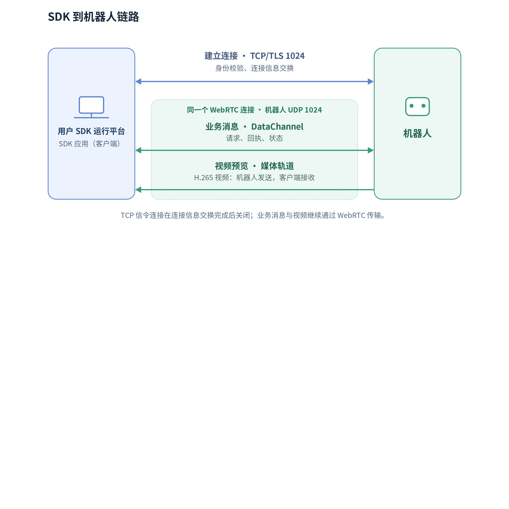
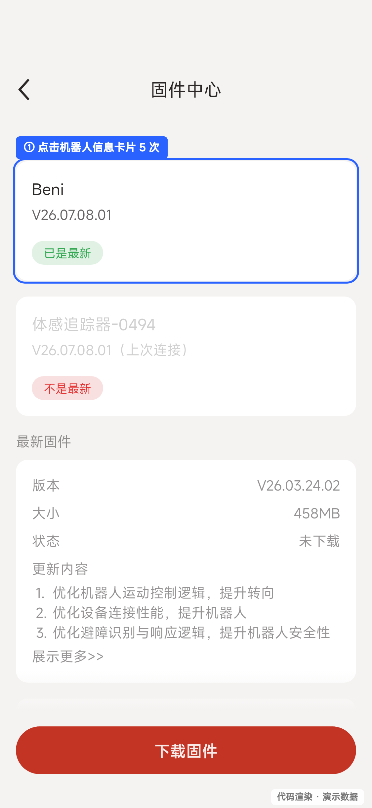
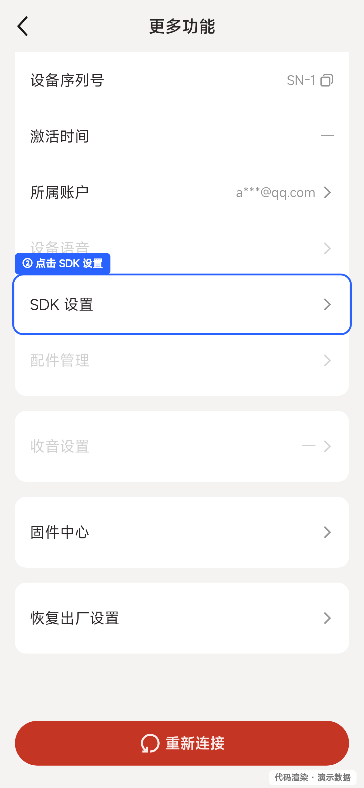
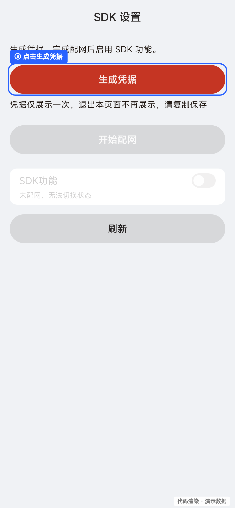
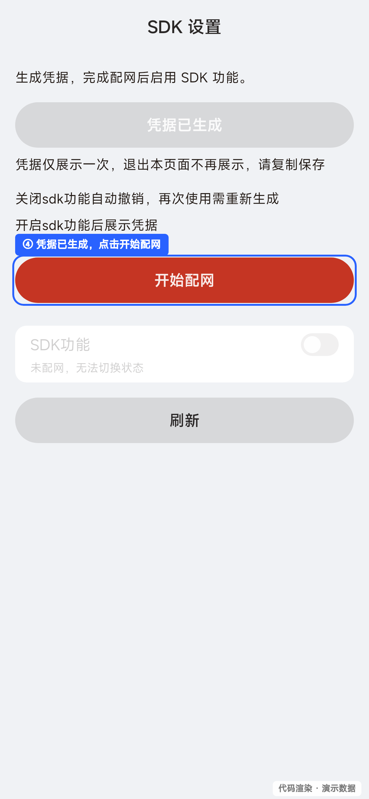
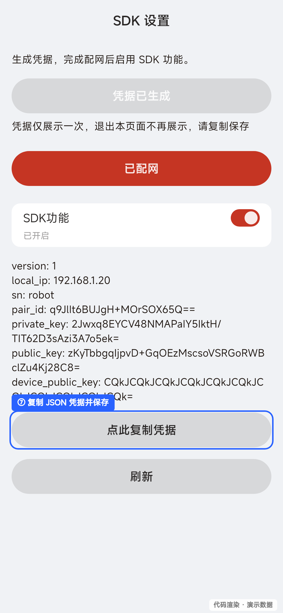
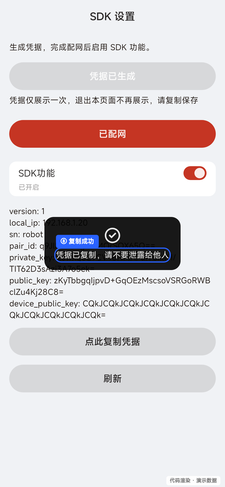
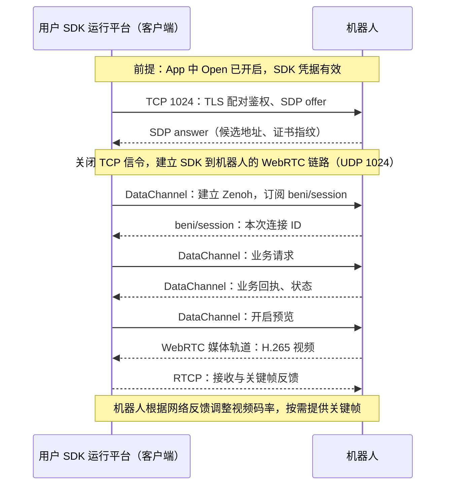

<a id="Htc0dF9pIokLuSxmCfpcUzB3npg"></a>

# MONDO SDK使用简介

[English version](<MONDO SDK User Guide.en.md>)

<a id="JamAd6aryoknClxBacWcPwJ2nfb"></a>

## 1 通信流程

<a id="doxcnmkpJIsqjTa0RszPkPQVKyd"></a>

本协议适用于 Linux／WSL 的 Beni 本地 SDK。用户 SDK 运行平台指运行用户开发的 SDK 应用的电脑等设备，本文将其中的 SDK 应用简称为“客户端”。

<a id="MM84dtvFuoSRqixLTOYcITCBnGd"></a>

客户端先通过 TCP/TLS 1024 与机器人完成配对身份校验和 SDP 交换，再建立 SDK 到机器人的 WebRTC 链路。业务请求、回执和主动上报走 DataChannel，H.265 视频走媒体轨道；两者共用 UDP 1024。

<a id="VAZddo82lopadex20IycpF4Un5g"></a>



<a id="YwVOdyy1dojihBx10dfc28BhnNg"></a>

### 1.1 接入准备

<a id="doxcnAPHeu6qz93RRRyjLbjvlNc"></a>

首次接入通过 Mondo App 完成：打开 SDK 设置 → 生成凭据 → 开始配网 → 启用 SDK 功能 → 复制并保存凭据。SDK 客户端需要与机器人处于可互通的局域网。

<a id="doxcnYDMlp5jgtFblz8L2tJRAkc"></a>

#### 打开 SDK 设置入口

1. 使用机器人所有者账号登录 Mondo App，连接目标机器人并确认设备 SN。生成凭据时需要保持与机器人的本地直连。
2. 进入**「固件中心」**，在**「设备信息」**中点击机器人信息卡片 **5 次**，开启 SDK 设置入口。
3. 返回**「设备管理」**，进入**「SDK 设置」**。

<a id="doxcnhMCMPA7FAbWs6fpg7jU27g"></a>

再次点击机器人信息卡片 5 次可隐藏入口。入口显隐只影响 App 菜单，不会关闭机器人上的 SDK 功能或撤销凭据。

<a id="doxcnIn7KcQW4uNHlX7MvpkeXef"></a>

<a id="doxcncHbIGgGTQRM0rOhnKAouye"></a>

<a id="doxcn0YSG335W4Q9GwHUrhn0VOd"></a>

**图 1：点击机器人信息卡片 5 次**

<a id="doxcnMSVCkaDlxY8nj6ZTwRH0Uf"></a>



<a id="doxcnrKhXLaTFl7QBHUeGEbC29g"></a>

<a id="doxcnGV3VtuzPi8bK7jtTbzMTye"></a>

**图 2：打开 SDK 设置**

<a id="doxcnARaoi0jBl4gQsSFlCUajRc"></a>



<a id="doxcnu4orNwBBz2PR2hyHQu5RRd"></a>

#### 生成凭据

1. 首次接入时，点击**「生成凭据」**。App 生成独立 SDK 密钥和配对标识。

<a id="doxcnZJCZfDJ4UdDH59Ys0XiVGg"></a>

> <a id="doxcnWVmVt5RmgoRR2OlRXlhBYf"></a>
>
> 凭据仅展示一次，退出页面不再展示，请复制保存

<a id="B2MWd1EZBo1TXGxVxIUcES2fnad"></a>

生成后进入下一步配网

<a id="doxcntauknVTpbGh1ck71v58GMc"></a>

<a id="doxcnF5jpFUzBdn3TAp6EjyxIPh"></a>

<a id="doxcnls3k8mwkimJFQ8Hc7pnoXe"></a>

**图 3：生成凭据**

<a id="doxcnSrW1Ly1fOTAljiMzpR2IRe"></a>



<a id="doxcnchn0182izZ7XyUMSkA1Xxd"></a>

<a id="doxcnlGNUg07bmRsSzHonsMjsGd"></a>

**图 4：凭据已生成，开始配网**

<a id="doxcnrUFQ0f6h5yXONj0PYtYJVe"></a>



<a id="doxcnCI18Om69zMUbbXNOD3ecgf"></a>

#### 开始配网

1. 点击**「开始配网」**，进入**「Wi-Fi 管理」**页面，将机器人连接到可访问互联网的 Wi-Fi。
2. 完成后返回 SDK 设置。
3. 如果机器人已联网但页面状态尚未更新，可点击**「刷新」**。

<a id="doxcnIe65sNLbJfBJuIrTc6BxBh"></a>

未确认 Wi-Fi 在线时，SDK 功能开关不可点击。开启和关闭 SDK 功能都需要满足机器人可连接互联网。

<a id="doxcnFSE2Hs9CWbFMblc8h12JTc"></a>

#### 启用 SDK 并复制凭据

1. 本页已生成凭据且机器人 Wi-Fi 在线后，打开**「SDK功能」**开关，等待设备状态确认**「已开启」**。
2. 启用后，页面以“字段名:字段值”的形式逐行展示本次生成的凭据
3. 点击复制，取得完整 JSON。凭据仅设置时展示一次，请在退出 SDK 设置前复制或截图保存好 JSON，供客户端接入使用。

<a id="doxcnO5jd2xd6EW2vlX8VtryhMf"></a>

JSON 包含 sn、pair_id、private_key、public_key、device_public_key 等字段，以及取得的 local_ip 和凭据代次信息。若 local_ip 为空，可先刷新；若地址变化，以机器人当前局域网 IP 为准，并确认客户端可访问该地址。

<a id="doxcn5712v0TpU5IICD15NnPYFr"></a>

<a id="doxcnb0lZ3QQ775XBKhLA9JIDRZ"></a>

<a id="doxcnYBWYnfvotqDYpBvfgh1u4f"></a>

**图 ****5****：复制并保存 JSON 凭据**

<a id="doxcnAffQ44TPrmmY79gIwTJMPg"></a>



<a id="doxcnFNg58mK3d0YRMXtMvii0Re"></a>

<a id="doxcn7158B0NoMMruQ4Azt3iExe"></a>

**图 ****6****：复制成功提示**

<a id="doxcnnbH9zWCTZ43d4uIW9rwnOd"></a>



<a id="doxcnxjpbReNE5Xr55iMOJ7xcke"></a>

#### 凭据有效性与再次接入

- App 不持久保存本次生成的私钥。退出 SDK 设置后，不能通过重新打开页面找回或再次复制旧凭据；请及时复制保存凭据。
- 页面状态以机器人实际授权状态为依据。退出 App、清除 App 数据或隐藏入口不会主动撤销机器人现有授权。
- 关闭 SDK 功能后，旧凭据撤销，已有 SDK 会话结束。再次使用需要重新生成凭据、启用 SDK。
- 如果机器人显示 SDK 已开启，但已保存的凭据丢失，请在机器人联网状态下关闭 SDK，确认关闭后重新生成并启用。

<a id="doxcnCYMHszpZ6oATSRD6lfr0jg"></a>

### 1.2 建立连接

<a id="doxcnjBUPETlavLyFoLfmOtAANf"></a>

客户端读取 App 导出的 SDK 凭据 JSON，连接机器人当前的局域网 IP。用户 SDK 运行平台需支持 TLS 1.3 外部 PSK、WebRTC H.265 接收，以及可靠有序的二进制 DataChannel。SDK 到机器人的链路通过 DataChannel 传输 Zenoh 字节流。

<a id="doxcn33RDglBT81Y2HxdEsGaZYf"></a>

### 1.3 通信时序

<a id="doxcnVXxnD01lyaBf78JhATPe3e"></a>



<a id="doxcnsbVHWx7BpqELaP5SjeVarY"></a>

## 2 WebRTC 局域网连接

<a id="doxcn1F0MFwuwia4NpUwMGNzxBd"></a>

客户端使用机器人当前 Wi-Fi 局域网 IPv4 地址的 **1024 端口**，网络需同时允许 TCP 和 UDP。机器人同时只接受一个 SDK 客户端连接。

<a id="doxcnqjzat2En27qfTZepDvh6De"></a>

| 内容 | 通路 | 承载方式 |
| --- | --- | --- |
| 身份校验、SDP | TCP/TLS 1024 | 配对密钥认证；Zenoh 交换 SDP |
| 命令、预览开关、回执、状态 | WebRTC / UDP 1024 | DataChannel 内承载 Zenoh 与 Protobuf |
| H.265 视频 | 同一 WebRTC / UDP 1024 | 媒体轨道，RTP/SRTP |
| 网络与关键帧反馈 | 同一 WebRTC / UDP 1024 | RTCP |

<a id="doxcnRL9OAiTw0THKID3A5YlQDb"></a>

### 2.1 配对鉴权与 SDP 交换

<a id="doxcnaD2d1pCLqxxzJXBPI4ckUc"></a>

客户端使用 SDK 私钥与机器人 X25519 公钥协商共享秘密。HKDF-SHA256 以 16 字节 pair_id 为 salt，ASCII 字符串 `Beni LAN TLS 1.3 external PSK v1` 为 info，派生 32 字节外部 PSK。机器人使用当前有效的 SDK 配对凭据计算对应密钥。

<a id="doxcnekq3FEMzCU7cQukg1lN0hb"></a>

双方使用 TLS 1.3 外部 PSK 认证身份，身份标识为 `Beni-SDK-v1`，套件为 `TLS_AES_128_GCM_SHA256`。客户端确认握手选用了配对密钥后，通过该 TLS 连接交换 SDP。

<a id="doxcnjmdLZb8IBCxWJLH3C3K1lf"></a>

客户端创建 H.265 接收轨道和名为 `beni` 的 DataChannel，采用可靠、有序的二进制消息。双方收集完 ICE 候选后发送完整 SDP。

<a id="doxcnbEO8sins5eyFCwNqTv57hD"></a>

```
app/sdk/webrtc/offer       // 客户端 → 机器人：完整 UTF-8 SDP offer
device/sdk/webrtc/answer   // 机器人 → 客户端：完整 UTF-8 SDP answer
encoding: application/octet-stream
```

<a id="doxcnzOQScgBhaVmOd2hm43ymS4"></a>

客户端先订阅 answer，再发布 offer；这两条信令消息无需业务会话 attachment。SDP 包含候选地址和证书指纹。双方按已认证 SDP 的指纹验证 DTLS 证书，由 WebRTC 协商视频和 DataChannel 的会话密钥。

<a id="doxcnyBpORIy4RRGEHU2F2kuZ5f"></a>

机器人仅提供 Wi-Fi 局域网的 IPv4/UDP 1024 候选地址，不使用公网 STUN/TURN 或 ICE TCP。视频与 DataChannel 使用 BUNDLE，并复用 RTP/RTCP 端口。

<a id="doxcnhagonqENjhCEu7M7onheke"></a>

### 2.2 业务会话与撤权

<a id="doxcng3IMT2oZAfDvWviXi25dRb"></a>

DataChannel 可用后，客户端在其中建立 Zenoh 会话并订阅 `beni/session`，取得 17 字节通知：前 16 字节是随机连接 ID，最后一字节保留，当前值为 0。向机器人发布业务消息时，在 attachment 中携带本次连接 ID。

<a id="doxcnSNdblyiX3JK74OoFQMGi6a"></a>

SDP 交换结束后，机器人关闭 TCP 信令连接，SDK 到机器人的 WebRTC 链路独立继续传输。机器人持续检查本次授权；关闭 Open、更换凭据或清空授权时，对应 WebRTC 会话结束，原会话中的请求关联失效。

<a id="doxcnEPRxF4MLfKfILY2cF0wX0c"></a>

若SDP 结束后 30 秒内未建立 DataChannel，机器人将结束本次连接。WebRTC 会话结束后，客户端需重新鉴权、交换 SDP，并取得新的连接 ID。

<a id="doxcnyWdSIHmqOfFPGmG9woc9Hg"></a>

## 3 业务消息与订阅

<a id="doxcnxy4g3qYK8Dmq9GYzuUy8sc"></a>

### 3.1 消息路由

<a id="doxcns0KxjXqXwYtO2UqkMLtIEZ"></a>

客户端向机器人发送消息时，key 为 `app` 加规范 topic；接收机器人消息时，key 为 `device` 加规范 topic。消息需符合当前会话授权、机器人支持范围和开放表规定的方向。以下列举常用消息。

<a id="doxcn2zgYcu5N5UJpXDf3W06dte"></a>

```
版本查询   app/cmd/common/get_version_req → device/cmd/common/get_version_rsp
手动模式   app/cmd/mission/request → device/cmd/mission/request_ack
摇杆控制   app/cmd/rc/joystick
调度状态   device/status/scheduler/status
预览开关   app/cmd/vt/sdk_preview_req → device/cmd/vt/sdk_preview_rsp
视频       WebRTC H.265 媒体轨道（见 4.3）
```

<a id="doxcn2bYsAiZ4g7IZvZw8outsLb"></a>

### 3.2 请求与回执

<a id="doxcnnAItU2TFvKtJrsdmFCZsrs"></a>

对声明了请求／回执关系的操作，填写非零 header.seq_num，按当前会话、响应 key 及原序号匹配；其他会话的响应不对本连接可见。单向消息直接发布，主动上报按 topic 订阅。可调用 `Client.request()`、`publish()`、`subscribe()` 和 `poll()`。

<a id="doxcnUlLqSxcNz4hQIDp2fY2BIh"></a>

### 3.3 业务数据编码与发送

<a id="Tp0pdGkIfoH2KqxLRrucb6oCnCh"></a>

#### 3.3.1 Protobuf 编码

<a id="EpbZdUzgVo6t2lxegk3cE3QWncc"></a>

业务数据包采用 Protobuf 编码，外层结构称为 **Envelope**。`header` 是消息头，其中的 `seq_num` 是请求编号，用于对应请求和回复；`data` 承载具体业务字段。

<a id="doxcnSK7N9ZvHdmTil65GbkAzwf"></a>

```
业务数据包（Envelope）
├─ header（tag 1）：请求／回执按协议携带；RcJoystick 必须省略整个 header
│  └─ seq_num（tag 1）：需要关联回执时，填写非零 uint32 请求编号
└─ data（tag 2）：业务内容
```

<a id="XViZdxjJ1ov6XYxAeJAcWuvhnRe"></a>

tag 是字段编号，各层分别编号。`data` 即使没有业务字段，也须编码为空子消息：`12 00`。

<a id="doxcnx5GY5H75K1e1laMOrH9z9Q"></a>

#### 3.3.2 发布和接收

<a id="doxcnp8ZZ3CJKYjnyXpxCP1OVcc"></a>

发布业务消息时，将 Protobuf 序列化为 Zenoh 样本的 payload，encoding 设为 `application/protobuf`，attachment 设为当前连接 ID。客户端与机器人通过 DataChannel 二进制消息传输 Zenoh 字节流，保留流本身的长度编码；一条 DataChannel 消息可承载部分或多个 Zenoh 帧，空二进制消息直接忽略。收到样本后，按完整 key 选择对应的 Protobuf 描述并解码。

<a id="doxcnZvXArbLl3P4LiOdyQBro8f"></a>

SDK 示例 提供 `beni_protocol.json`，包含消息方向、Protobuf 消息描述与已声明的回执关系。可使用 `client.types[topic]` 构造消息并通过 `publish_message()` 发送。视频传输定义见第 4.3 节。

<a id="DpRudAPJFozrTexOh7mccfKhn2g"></a>

## 4 典型数据包

<a id="GJIidj0wCoDuKOx3iDwcbRvZn7c"></a>

本章介绍三类常用的数据包，其余可在附件中查看：

- **业务数据包**：用于模式配置、运行参数查询与更新，以及状态查询与上报。
- **控制数据包**：用于运动、姿态及动作控制。
- **视频数据包**：用于接收机器人发送的视频码流。

<a id="LecHdeuSMow699xqMimcBX9Mnpf"></a>

### 4.1 业务数据包

<a id="doxcnoyLe0ACHGAC1QjURGrQggb"></a>

下列字段表用作业务编码参考。机器人对支持的请求按协议解码，根据当前状态和相应业务规则校验、执行。客户端应以实际回执或状态上报确认结果。

<a id="doxcnI4f6mhvZyAssNRc0AOfT0f"></a>

#### 4.1.1 模式切换（app/cmd/mission/request、device/cmd/mission/request_ack）

<a id="U2sjdDhouocLNOx5STScuP3dnJh"></a>

模式分为主模式和子模式：`mission_id` 选择主模式，`sub_mode` 选择该主模式下的工作方式。

<a id="ZFWtdnAHJoCo7lxiCk0cWurAnqc"></a>

| mission_id | 主模式 | 用途 |
| --- | --- | --- |
| 0 | 保留 | -- |
| 1 | Camera | 拍摄与手动控制。 |
| 2 | Game | 游戏。 |

<a id="NWnZds0M9oxhAzxjsEbceK41nVe"></a>

Camera 主模式包含以下子模式：

<a id="OJpCdkoeGoqGTuxds55cIl1Inbh"></a>

| sub_mode | 子模式 | 用途 |
| --- | --- | --- |
| 0 | Manual（手动） | 接收客户端摇杆指令输入，按照输入摇杆量执行运动 |
| 1 | Spotlight（聚焦） | 仅云台锁定目标，通过摇杆指令控制机器运动 |
| 2 | Follow（跟随） | 自主跟随目标。 |

<a id="doxcnPMShgBdpU4D62WppF9zcIh"></a>

以下以 Camera／Manual（mission_id=1、sub_mode=0）说明SDK 示例的调用方式。客户端填写目标主模式、子模式及模式参数，机器人负责校验和执行。

<a id="LqSTdbL3To855PxlxVpc33W9nJf"></a>

模式切换包含请求包和回复包：请求包指定目标主模式、子模式及模式设置；回复包给出处理结果、当前模式和错误码。两者均采用 [3.3.1 Protobuf 编码](#Tp0pdGkIfoH2KqxLRrucb6oCnCh)，包含 `header` 和 `data`，下列 data 字段均必需存在。

<a id="PDzKdBUBnoJOykxZvlVcqMagn5c"></a>

**数据包标识**

<a id="SwYCdV0pAofv6jxy9x7cANbLnmg"></a>

| 方向 | 完整消息路由 | 数据包 |
| --- | --- | --- |
| 客户端 → 机器人 | app/cmd/mission/request | 模式切换请求包 |
| 机器人 → 客户端 | device/cmd/mission/request_ack | 模式切换回复包 |

<a id="Kjp2dUOUwoxPuGxIyawcI0sSnVc"></a>

**模式切换请求包（app/cmd/mission/request）**

<a id="G2kvdLTjqowVsFxDhq5cVucVn3e"></a>

```
模式切换请求包
├─ header（tag 1）
│  └─ seq_num（tag 1）：非零 uint32 请求编号
└─ data（tag 2）
   ├─ version（tag 1）：请求格式版本
   ├─ mission_id（tag 2）：目标主模式
   ├─ sub_mode（tag 3）：目标子模式
   └─ mode_params（tag 4）：9 字节模式设置
```

<a id="XeLQdd7Vmo8nJMxQcGsc3Wsdnih"></a>

| data tag | 字段 | 编码与说明 |
| --- | --- | --- |
| 1 | version | uint32/u8，固定 1，请求格式版本。 |
| 2 | mission_id | uint32/u8，1 表示 Camera 主模式。 |
| 3 | sub_mode | uint32/u8，0 表示 Manual 子模式。 |
| 4 | mode_params | bytes，固定 9 B，按下表逐字节填写。 |

<a id="MjxIdaQRPoxpQ0xVonhcZ0lGnNh"></a>

**mode_params 字节布局**

<a id="Zy18dveL6oJzqExBONrcXtCPnbh"></a>

| 索引 | 中文设置项 | 取值 |
| --- | --- | --- |
| 0 | 驾驶方式 drive_mode | 0：机体转向与云台偏转分别控制。 云台保持相对机体的偏转角度，机体转向时，镜头朝向随之转动。<br>1：以镜头朝向为移动参考。 云台保持朝向，通过云台转向输入调整镜头方向；机体根据移动输入自动调整行驶方向，未输入移动指令时，机体转向与云台对齐。 |
| 1 | --保留 | -- |
| 2 | --保留 | -- |
| 3 | --保留 | -- |
| 4 | --保留 | -- |
| 5～8 | 保留项 | 各字节全部发送 0。 |

<a id="Ay1gdSHN0oh2UKx8s6bcHlu4nhb"></a>

**模式切换回复包（device/cmd/mission/request_ack）**

<a id="XfwKdplm0oMgfKxC1ZYcN7X1nJx"></a>

```
模式切换回复包
├─ header（tag 1）
│  └─ seq_num（tag 1）：对应请求的编号
└─ data（tag 2）
   ├─ result_code（tag 1）：处理结果
   ├─ current_mission_id（tag 2）：当前主模式
   ├─ current_sub_mode（tag 3）：当前子模式
   ├─ error_code_lo（tag 4）：错误码低 8 位
   └─ error_code_hi（tag 5）：错误码高 8 位
```

<a id="O8qDdjnLQoTIrQxaOCVcW6EOnIe"></a>

| data tag | 字段 | 编码与说明 |
| --- | --- | --- |
| 1 | result_code | uint32/u8：0 成功；1 主模式处理失败；2 子模式处理失败；3 模式设置处理失败。 |
| 2 | current_mission_id | uint32/u8，当前主模式。 |
| 3 | current_sub_mode | uint32/u8，当前子模式。 |
| 4 | error_code_lo | uint32/u8，错误码低 8 位。 |
| 5 | error_code_hi | uint32/u8，错误码高 8 位。 |

<a id="GaBBd1B3boQg3NxpKlXcHRhon9g"></a>

**回复处理**

- 保存模式请求上下文，按当前会话、回复路由及相同的 `header.seq_num` 匹配。未完成编号不复用；结束等待后退役编号，迟到或未匹配回复不完成其他请求。
- 等待须有限，协议未规定统一期限。超时按结果未知处理，先读取当前模式，不自动重放模式请求。

<a id="QFtDdkDOSoRnmcxVyDScNlr7nnf"></a>

#### 4.1.2 运行参数（app/cmd/parameter/query_req、device/cmd/parameter/query_rsp、app/cmd/parameter/update_req、device/cmd/parameter/update_rsp）

<a id="HqWEdRCgaooEn3xbzkzctjRhnfc"></a>

运行参数数据包用于查询或修改手动控制（Manual）的最大速度、转向角速度、动力响应等设置。可用参数及取值见下表。

<a id="INXidDYrrodtIZxFHVFckIaanHc"></a>

**参数目录**

<a id="Myuad45vroyckqxkHY9cVcyynvb"></a>

| 参数 ID | 名称 | 单位 | 取值范围 |
| --- | --- | --- | --- |
| 1 | 最大速度 | m/s | 0～8 |
| 2 | 最大转向角速度 | °/s | 30～250 |
| 3 | 动力响应 | — | 1、2、3 |
| 16 | 车身／底盘协同权重 | — | 0～1 |
| 17 | 滤波参数 | — | 0.01～1 |
| 18 | 最小转弯设置 | — | 0、1 |

<a id="LDIFdyLdGoadGOxmwyGc08RYnTb"></a>

**查询包**

<a id="Op6ZdozJ5omjcQxgILCcNiRGnCc"></a>

本节四种数据包均包含 `header` 和 `data`，以 `header.seq_num` 关联请求与回复；表中 data 字段均必需存在。公共编码见 [3.3.1 Protobuf 编码](#Tp0pdGkIfoH2KqxLRrucb6oCnCh)。

<a id="O495doY5moAdKexSdVgcm0XBnsg"></a>

| 方向 | 完整消息路由 | 数据包 |
| --- | --- | --- |
| 客户端 → 机器人 | app/cmd/parameter/query_req | 参数查询请求包 |
| 机器人 → 客户端 | device/cmd/parameter/query_rsp | 参数查询回复包 |

<a id="Ufa8dJqTpoKo2oxYCCZcATzwn9g"></a>

**参数查询请求包（app/cmd/parameter/query_req）**

<a id="Huh1dWnqeo50fgxQC2ScREhEnkb"></a>

```
参数查询请求包
├─ header（tag 1）
│  └─ seq_num（tag 1）：非零 uint32 请求编号
└─ data（tag 2）
   ├─ mode_type（tag 1）：参数组编号
   ├─ param_id（tag 2）：要查询的参数 ID
   └─ reserved（tag 3）：2 字节保留项，全零
```

<a id="NUJgdczZJonjfQxnx70cxwY6ntb"></a>

| data tag | 字段 | 编码与说明 |
| --- | --- | --- |
| 1 | mode_type | uint32/u8，本节固定填 1，选择手动控制参数组。 |
| 2 | param_id | uint32/u8，填写[参数目录](#INXidDYrrodtIZxFHVFckIaanHc)中要查询的参数 ID。 |
| 3 | reserved | bytes[2]，全零。 |

<a id="LzF5dOZ0VoBy26xiTMIcLv4Pnbg"></a>

`mode_type` 选择参数组，不切换机器人模式。模式切换请求中的 `sub_mode=0` 表示 Manual，见[4.1.1 模式切换](#doxcnI4f6mhvZyAssNRc0AOfT0f)；两者分别填写。

<a id="QMVHdMgfgovIW5xIHSnce8qYnnl"></a>

**参数查询回复包（device/cmd/parameter/query_rsp）**

<a id="ELEfdycvioRgpLxsA8XcKyPrnhe"></a>

```
参数查询回复包
├─ header（tag 1）
│  └─ seq_num（tag 1）：对应请求的编号
└─ data（tag 2）
   ├─ mode_type（tag 1）：回显参数组编号
   ├─ param_id（tag 2）：回显参数 ID
   ├─ ret_code（tag 3）：查询结果
   ├─ reserved（tag 4）：保留项，显式为 0
   └─ param_value（tag 5）：查询得到的参数值
```

<a id="LTlcdIFdiooFjjxBAnjcBDjenne"></a>

| data tag | 字段 | 编码与说明 |
| --- | --- | --- |
| 1 | mode_type | uint32/u8，固定值为1。 |
| 2 | param_id | uint32/u8，回显请求的参数 ID。 |
| 3 | ret_code | uint32/u8：0 成功；1 参数不支持；2 模式不支持。 |
| 4 | reserved | uint32/u8，显式为 0。 |
| 5 | param_value | float/f32，当前参数值，单位和取值范围见本节“参数目录”表。 |

<a id="EVttdhIqpoKiZ0xDEfacmlo9nLe"></a>

**修改包**

<a id="KTNidzcQaoHRoTxU11Wc8s5mnWg"></a>

修改时，填写参数组编号 `mode_type`、参数编号 `param_id` 和目标参数值 `param_value`。机器人返回更新结果。

<a id="TAajdNtfqooGdqxjoxKcp7PNnhd"></a>

| 方向 | 完整消息路由 | 数据包 |
| --- | --- | --- |
| 客户端 → 机器人 | app/cmd/parameter/update_req | 参数修改请求包 |
| 机器人 → 客户端 | device/cmd/parameter/update_rsp | 参数修改回复包 |

<a id="TnirdZuzbowLRMx9SgNci9dLnlb"></a>

**参数修改请求包（app/cmd/parameter/update_req）**

<a id="V3OodRWmKo1sebxEdSwcUih2nDe"></a>

```
参数修改请求包
├─ header（tag 1）
│  └─ seq_num（tag 1）：非零 uint32 请求编号
└─ data（tag 2）
   ├─ mode_type（tag 1）：参数组编号
   ├─ param_id（tag 2）：要修改的参数 ID
   ├─ param_value（tag 3）：目标参数值
   └─ reserved（tag 4）：2 字节保留项，全零
```

<a id="WevMdnmw4oyWHIxIZrbcfYodndb"></a>

| data tag | 字段 | 编码与说明 |
| --- | --- | --- |
| 1 | mode_type | uint32/u8，本节固定填 1，选择手动控制参数组。 |
| 2 | param_id | uint32/u8，填写[参数目录](#INXidDYrrodtIZxFHVFckIaanHc)中要修改的参数 ID。 |
| 3 | param_value | float/f32，要写入的目标参数值，单位及范围见参数目录；须为有限值，拒绝 NaN、Inf。 |
| 4 | reserved | bytes[2]，全零。 |

<a id="PxxkdRm4xoSqFaxJeu6cAy2Enef"></a>

**参数修改回复包（device/cmd/parameter/update_rsp）**

<a id="U9ded5c7loWwHTxmsM2ccw7Hnze"></a>

```
参数修改回复包
├─ header（tag 1）
│  └─ seq_num（tag 1）：对应请求的编号
└─ data（tag 2）
   ├─ ret_code（tag 1）：更新结果
   └─ reserved（tag 2）：3 字节保留项，全零
```

<a id="QsAudjjbRoTnCAxvUq7chAZWnJd"></a>

| data tag | 字段 | 编码与说明 |
| --- | --- | --- |
| 1 | ret_code | uint32/u8：0 已应用；1 无效；2 不支持；3 存储错误。收到回复后，再次查询确认实际值。 |
| 2 | reserved | bytes[3]，全零。 |

<a id="E34ydlm7JoUBhtxa3xzcbK2Ynmd"></a>

**必要规则**

<a id="O0sZdUIZFoFV8yxUzHNcL2aInib"></a>

| 规则 | 处理要求 |
| --- | --- |
| 回复匹配 | 按当前会话、预期回复路由和 header.seq_num 匹配；查询回复须回显相同 mode_type/param_id。更新回复不含参数 ID 或实际生效值，客户端保存“序号 → mode_type/param_id”映射。未完成编号不复用，结束等待后退役；迟到或未匹配回复不完成其他请求。 |
| 等待与超时 | 有限等待，协议未规定统一期限。超时按结果未知处理：查询可用新编号重查；更新先查询当前值，不自动重放。 |
| 参数确认 | 控制前查询 1/2/3/16/17/18 并明确目标。修改按“查询并保存原值 → 显式更新 → 匹配回复 → 再查询”进行，分别判断更新回复和实际生效值。 |
| 持久化与写入约束 | 参数持久化，断线后不自动还原；写入可能影响当前驾驶和后续输入，持久化失败按返回码处理。客户端不依赖越界钳制表达意图，也不把参数写 0 当作停止命令。 |

<a id="YlpGdG6rfofOUlxxAWUc2jpznlg"></a>

**参数生效说明**

<a id="doxcnC2Li8gDip7SkTq9meUM8pd"></a>

动力响应档位与滤波系数、前向加速度限制的对应关系如下：

<a id="WD4Kd1huDofxbFxjDgXcWvWUnTg"></a>

| 动力响应 | alpha | 前向加速度限制 |
| --- | --- | --- |
| 1 | 0.01 | 2 m/s² |
| 2 | 0.025 | 3.5 m/s² |
| 3 | 0.05 | 5 m/s² |

<a id="U6ZidDUi4omD8cxvfvFcuPU0nNE"></a>

#### 4.1.3 状态查询与上报

<a id="TOKXd16sFo8tBLxRknccy0oTn5f"></a>

**状态包目录**

<a id="OL6Cd2YC3oUWGNx5vbYczmsCnLJ"></a>

| 状态包 | 内容 | 接收方式 |
| --- | --- | --- |
| [模式状态](#HKpBdSA8PoykS7x6JuzcrhT6nYb) | 当前模式及安全状态。 | 接收机器人上报。 |
| [机身状态](#JkjEd59FVokSECxs0H9cZP0VnQf) | 机身阶段、速度、姿态和里程。 | 接收机器人上报。 |
| [电源状态](#HYFVdRMYbo4ZjIxmXPScyMU3nZg) | 电量、供电和充电状态。 | 接收机器人上报。 |
| [HMS 故障状态](#JYkNd4FRBotSLXx0FXEc7cwKnaf) | 活跃故障快照及变化事件。 | 查询快照，并接收事件。 |

<a id="HKpBdSA8PoykS7x6JuzcrhT6nYb"></a>

##### 模式状态（device/status/scheduler/status）

<a id="MGJ0dYwnVomxKVx1xOPcA8T1nRc"></a>

**方向：** 机器人 → 客户端；**消息路由：** `device/status/scheduler/status`。

<a id="SS8LdMKPEo4hjmxS7RCcEmLynZe"></a>

```
模式状态包（省略 header）
└─ data（tag 2）
   ├─ current_mode（tag 1）：当前主模式
   ├─ sub_mode（tag 2）：当前子模式
   ├─ request_source（tag 3）：请求来源原码
   ├─ is_locked（tag 4）：收纳状态
   ├─ is_paused（tag 5）：急停状态
   ├─ timestamp_ns（tag 6）：设备原始时间计数
   ├─ sub_mode_state（tag 7）：14 字节子模式状态
   ├─ ego_active（tag 8）：保留原码
   └─ obstacle_avoidance_flags（tag 9）：避障状态位
```

<a id="TH8Od0uLKokusAxUktycGddwn3d"></a>

| data tag | 字段 | 编码与说明 |
| --- | --- | --- |
| 1 | current_mode | uint32/u8；Camera 为 1。 |
| 2 | sub_mode | uint32/u8；Manual 为 0。 |
| 3 | request_source | uint32/u8，保留来源原码，不用作独占控制判据。 |
| 4 | is_locked | uint32/u8，收纳状态：0 起身，1 收纳。 |
| 5 | is_paused | uint32/u8，急停状态：0 正常，1 急停。急停时停止所有运动输入，保持静止站立。 |
| 6 | timestamp_ns | uint64/u64，设备原始时间计数，不按 Unix 时间解释或与客户端时钟直接相减。 |
| 7 | sub_mode_state | bytes[14]，按对应模式及版本解释；Manual 布局见下表。 |
| 8 | ego_active | uint32/u8，保留原码，不用作独占控制判据。 |
| 9 | obstacle_avoidance_flags | uint32/u8：bit0 请求、bit1 生效、bit2 介入、bit3 四状态布局支持，其余保留。 |

<a id="YZ1wdMzqjonqLaxSZFOc2vpFnyo"></a>

| Manual sub_mode_state 字节 | 含义 |
| --- | --- |
| 0 | 云台与机体联动方式：0 机体转向与云台偏转分别控制；1 以镜头朝向为移动参考，机体自动调整方向。 |
| 1 | 自动选择前进或倒车：0 机体转向目标方向后前进；1 允许通过倒车沿目标方向移动，减少机体转动。仅在以镜头朝向为移动参考的方式下生效。 |
| 2 | 速度／转弯半径优先标志：0 关闭，1 开启。当前保存并回显该设置。 |
| 3 | 当前速度挡位：0 慢速，1 标准，2 运动。 |
| 4 | 控制功能状态位：bit7 为 1 表示支持本状态布局，此时读取 bit0～2。bit0 表示航向闭环，bit1 表示制动，bit2 表示转向辅助，各位 0 关闭、1 开启。bit3～6 保留为 0。 |
| 5～13 | 保留字节，值为 0。 |

<a id="JkjEd59FVokSECxs0H9cZP0VnQf"></a>

##### 机身状态（device/status/robot/status）

<a id="SUybd8nvwovjs2xStyLcY3wYnIc"></a>

**方向：** 机器人 → 客户端；**消息路由：** `device/status/robot/status`。

<a id="FY7qdp7ZNoFedJxwg9ScHoP9nlb"></a>

```
机身状态包（省略 header）
└─ data（tag 2）
   ├─ robot_state（tag 1）：机身状态
   ├─ velocity（tag 2）：运动速度
   ├─ trip_odom_dis（tag 3）：行程里程
   ├─ obstacle_dis（tag 4）：障碍物距离
   ├─ pitch_angle（tag 5）：俯仰角
   ├─ gimbal_angle（tag 6）：云台角度
   ├─ roll_angle（tag 7）：横滚角
   ├─ height（tag 8）：机身测量高度
   ├─ sport_mode（tag 9）：运动模式原码
   ├─ abnormal_flags（tag 10）：异常标志
   └─ session_odom_dis（tag 11）：会话里程
```

<a id="W0itdGcCWon7ixx3Afzc9rvqn5B"></a>

| data tag | 字段 | 编码与说明 |
| --- | --- | --- |
| 1 | robot_state | uint32/u8：0 Released、1 StandingUp（起身中）、2 SittingDown（收纳中）、3 Active。Active 也可用于恢复阶段，Released 也可能来自终止故障。 |
| 2 | velocity | sint32/i16，cm/s；除以 100 得到 m/s。 |
| 3 | trip_odom_dis | float/f32，m。 |
| 4 | obstacle_dis | uint32/u16，cm；0xFFFF 无效。 |
| 5 | pitch_angle | sint32/i16，0.1°。 |
| 6 | gimbal_angle | sint32/i16，0.1°。 |
| 7 | roll_angle | sint32/i16，0.1°。 |
| 8 | height | uint32/u8，0.1 cm，机身测量高度，与控制包高度原码分别解释。 |
| 9 | sport_mode | uint32/u8，保留原码，不作为动作成功或控制准入回执。 |
| 10 | abnormal_flags | uint32/u32，非零视为异常，不猜测位名后忽略。 |
| 11 | session_odom_dis | float/f32，m。 |

<a id="HYFVdRMYbo4ZjIxmXPScyMU3nZg"></a>

##### 电源状态（device/status/pmu/osd_status）

<a id="WX4EdLBcOoeVrzxsp9Hc5Ifbnfh"></a>

**方向：** 机器人 → 客户端；**消息路由：** `device/status/pmu/osd_status`。

<a id="NKMYdXwU9oLp67x5kewcY5MDngd"></a>

```
电源状态包（省略 header）
└─ data（tag 2）
   ├─ soc（tag 1）：电量百分比
   ├─ power_bits（tag 2）：供电与充电状态位
   └─ abnormal_flags（tag 3）：异常标志
```

<a id="QNAXdTcNRo1G3Cxs1sGcKcJ0n4l"></a>

| data tag | 字段 | 编码与说明 |
| --- | --- | --- |
| 1 | soc | uint32/u8，电量百分比 0..100。 |
| 2 | power_bits | uint32/u8：bit0 外部电源存在，bit1 正在充电，其余保留。 |
| 3 | abnormal_flags | uint32/u16，非零视为异常。 |

<a id="JYkNd4FRBotSLXx0FXEc7cwKnaf"></a>

##### HMS 故障状态（app/status/hms/query_active、device/status/hms/active_snapshot、device/status/hms/event_broadcast）

<a id="SYDjdyXlkozalExkP2XcctiWnad"></a>

故障码含义及已登记的实例、等级和提示文案见 [HMS 故障码参考表](<HMS 故障码参考表.html>)。

<a id="Zu8SdapqHotgVexMVhQcIqGMnxg"></a>

| 方向 | 完整消息路由 | 数据包 |
| --- | --- | --- |
| 客户端 → 机器人 | app/status/hms/query_active | HMS 活跃故障查询包 |
| 机器人 → 客户端 | device/status/hms/active_snapshot | HMS 活跃故障快照包 |
| 机器人 → 客户端 | device/status/hms/event_broadcast | HMS 故障事件上报包 |

<a id="FR10dHYFzoZXBCxI1vpcT9F5nVf"></a>

```
HMS 活跃故障查询包（省略 header）
└─ data（tag 2）
   ├─ filter_kind（tag 1）：查询范围
   ├─ _pad0（tag 2）：保留字段，显式为 0
   ├─ module_id（tag 3）：目标模块 ID
   └─ request_id（tag 4）：非零查询编号
```

<a id="V6vpdwDFWoJJTyxUIdHcfBqHnte"></a>

| data tag | 字段 | 编码与说明 |
| --- | --- | --- |
| 1 | filter_kind | uint32/u8，查询范围：0 查询全部模块，1 查询指定模块。 |
| 2 | _pad0 | uint32/u8，保留字段，固定值为 0。 |
| 3 | module_id | uint32/u16，模块编号。查询全部模块时填 0；查询指定模块时填写目标模块编号。 |
| 4 | request_id | uint64/u64，本次查询的编号，填写非零值。回复携带相同编号，用于对应本次查询。 |

<a id="XiCXdSWGIogK6gxUPO5c84EknTe"></a>

```
HMS 活跃故障快照包（省略 header）
└─ data（tag 2）
   ├─ at_offset（tag 1）：事件水位
   ├─ count（tag 2）：故障条目数量
   ├─ module_ids（tag 3）：模块 ID 数组
   ├─ fault_codes（tag 4）：完整故障码数组
   ├─ instance_ids（tag 5）：故障实例 ID 数组
   ├─ severities（tag 6）：故障等级数组
   ├─ first_assert_ts（tag 7）：首次出现时间数组
   ├─ last_update_ts（tag 8）：最近更新时间数组
   ├─ daemon_instance_id（tag 9）：服务代次
   ├─ state_revision（tag 10）：状态版本
   ├─ recovery_state（tag 11）：恢复状态
   ├─ ret_code（tag 12）：查询结果
   └─ request_id（tag 13）：对应查询的编号
```

<a id="Xg5LdLNItoBRyexejhjcicrHnsb"></a>

| data tag | 字段 | 编码与说明 |
| --- | --- | --- |
| 1 | at_offset | uint64/u64，生成本次故障列表时对应的最新故障事件编号。 |
| 2 | count | uint32/u32，本次返回的故障数量，范围 0～256。 |
| 3 | module_ids | repeated uint32，各条故障所属的模块编号，取值大于 0。 |
| 4 | fault_codes | repeated uint32，各条故障的完整故障码，高 16 位为对应的模块编号。 |
| 5 | instance_ids | repeated uint32，各条故障的实例编号，范围 0～65535，用于区分同一故障码的不同实例。 |
| 6 | severities | repeated uint32，各条故障的等级：0 信息、1 警告、2 错误、3 致命。 |
| 7 | first_assert_ts | repeated uint64，各条故障首次出现的时间计数，单位 ms。 |
| 8 | last_update_ts | repeated uint64，各条故障最近更新的时间计数，单位 ms。 |
| 9 | daemon_instance_id | uint64/u64，当前 HMS 服务实例的编号，值非零。编号变化后重新查询故障列表。 |
| 10 | state_revision | uint64/u64，故障状态的版本号，用于识别状态更新。 |
| 11 | recovery_state | uint32，故障状态的就绪情况：0 无效、1 恢复中、2 已就绪。 |
| 12 | ret_code | uint32/u32，查询结果：0 成功、1 查询条件无效、2 故障数量超过容量上限。 |
| 13 | request_id | uint64/u64，对应查询请求的编号，与请求中的 request_id 相同。 |

<a id="GxIldwDr7o1rOLxZQVEcfStvnTh"></a>

第 3～8 项为数组，每个数组包含 count 个元素，相同下标对应同一条故障。

<a id="JQ32dCDJOoVpFdxVaiUcwQutnob"></a>

**条目校验**

- 按字段表检查六个数组中每个元素的取值范围和数组长度：数组长度均等于 count，count 为 0～256，故障等级为 0～3。时间值为设备内部计数，单位 ms，不能直接作为日期时间显示。
- 同一条故障的首次出现时间应小于或等于最近更新时间，即 first_assert_ts[i] ≤ last_update_ts[i]。同一份故障列表中，完整故障码与 instance_id 的组合应唯一。

<a id="WOgwdUtMiop49LxckjjcB0oinob"></a>

```
HMS 故障事件上报包（省略 header）
└─ data（tag 2）
   ├─ offset（tag 1）：故障事件编号
   ├─ module_id（tag 2）：模块 ID
   ├─ fault_code（tag 3）：故障码低 16 位
   ├─ instance_id（tag 4）：故障实例 ID
   ├─ kind（tag 5）：事件类型
   ├─ severity（tag 6）：故障等级
   ├─ timestamp_ms（tag 7）：时间计数（ms）
   ├─ daemon_instance_id（tag 8）：HMS 服务实例编号
   ├─ state_revision（tag 9）：故障状态版本号
   ├─ origin（tag 10）：事件来源
   └─ recovery_state（tag 11）：故障状态就绪情况
```

<a id="IKDVdaFlEoDAJ7xdnhTc6QWtn1b"></a>

| data tag | 字段 | 编码与说明 |
| --- | --- | --- |
| 1 | offset | uint64/u64，本条故障事件的编号，用于识别事件顺序。 |
| 2 | module_id | uint32/u16，发生故障的模块编号。 |
| 3 | fault_code | uint32/u16，故障码的低 16 位，与 module_id 组合得到完整故障码，计算方式见下方。 |
| 4 | instance_id | uint32/u16，故障实例编号，用于区分同一故障码的不同实例。 |
| 5 | kind | uint32/u8，事件类型：1 故障出现，2 故障解除，3 故障信息更新。 |
| 6 | severity | uint32/u8，故障等级：0 信息，1 警告，2 错误，3 致命。 |
| 7 | timestamp_ms | uint64/u64，故障事件发生的时间计数，单位 ms。 |
| 8 | daemon_instance_id | uint64/u64，当前 HMS 服务实例的编号。 |
| 9 | state_revision | uint64/u64，本事件对应的故障状态版本号。 |
| 10 | origin | uint32/u8，事件来源：0 无效，1 实时变化，2 状态重新同步，3 来源失联后的处理。 |
| 11 | recovery_state | uint32/u8，故障状态的就绪情况：0 无效，1 恢复中，2 已就绪。 |

<a id="GdbhdaN8MooorgxT5jXcbT1Qnke"></a>

事件中的完整故障码按以下方式还原：

<a id="ZfqVdMXAtowSnWxTpbRcMn00nIe"></a>

```
完整故障码 = (module_id << 16) | fault_code
```

<a id="NRIpd5sL6ouAlVx645AcMcEHnKb"></a>

**HMS 故障列表查询与更新规则**

- 回复匹配：查询返回当前完整故障列表，以下简称“快照”。保存本次查询的 request_id、所属连接和接收回复的 topic。只接收当前连接、预期 topic 且 request_id 相同的回复。等待中的查询使用不同编号；查询完成或超时后不再使用该编号，忽略迟到或未匹配的回复。
- 等待与超时：客户端设置有限的等待时间，协议未指定统一时长。超时表示尚未取得本次查询结果，可使用新的 request_id 重新查询故障列表。
- 查询顺序：先订阅 device/status/hms/active_snapshot 和 device/status/hms/event_broadcast，再发送查询。等待期间记录收到的 HMS 服务实例编号、故障状态版本号和故障事件编号，用于检查返回的故障列表是否为最新状态。
- 更新故障列表：收到匹配本次查询的成功回复，且 recovery_state=2（已就绪）、服务实例编号有效、状态版本和事件编号未落后时，更新本地故障列表。回复失败、状态未就绪、列表过期或数组校验失败时，标记本地列表待刷新；重新查询完成前，继续保留已有故障对应的控制限制。
- 重新查询：记录已接收的服务实例编号、状态版本和事件编号。服务实例编号变化、事件编号不连续或数据异常时，重新查询完整故障列表。忽略已失效服务实例的回复，以及版本或事件编号早于已接收状态的列表。状态未就绪时，继续保留已有故障对应的控制限制。
- 事件处理：事件通知用于告知故障的出现、解除或更新，完整故障集合通过快照获取。客户端可在收到事件后将本地列表标记为待刷新；连续收到多个事件时，合并为一次故障列表查询。
- 逐条更新：客户端也可以根据故障出现、解除和更新事件逐条更新本地列表。应用事件前，检查 HMS 服务实例编号一致，且 state_revision 和 offset 连续。查询返回的故障列表应覆盖已经收到的事件，其 at_offset 不小于已收到的故障事件编号。

<a id="doxcniFwR8Hx1zghBT99zKm3gif"></a>

### 4.2 手动控制（app/cmd/rc/joystick）

<a id="doxcnx9QJp4Pc0vSmUidmcy4Vtf"></a>

SDK 示例先申请 Camera／Manual 模式，收到成功回复后启用界面控制。机器人根据当前模式和控制参数处理运动请求，客户端通过请求回复和机器人状态确认处理结果。

<a id="doxcnnwdVnkivlaIoyKGDZmtI3g"></a>

向 `app/cmd/rc/joystick` 发布单向消息 `RcJoystick`，encoding 使用 `application/protobuf`，Zenoh attachment 填本次控制会话的 16 字节 ID。Protobuf 只填写 `data.joystick`，必须省略整个 `header`；即使 header 为空，机器人也会拒绝解码。`data.joystick` 为 用于编码摇杆指令的 64 位整数，其中包含前后／转向、云台水平转向、俯仰、机体横滚、高度、跳跃、翻转、挡位、导航、急停、收纳／起身，以及 bit60 俯仰输入方式、bit61 第三人称模式、bit62 跳跃模式和 bit63 预览开关标志。编码校验示例：`data.joystick = 1000` 的完整载荷为 `12 03 08 E8 07`。此数值仅用于校验序列化。

<a id="doxcnM9Wk4w1Fv4mCUSHjTE2YFd"></a>

SDK 示例中，前进和转向输入范围为 0～2000，中间值为 1000。SDK 到机器人的链路原样传递摇杆输入，不按轴值丢弃消息，也不因急停或收纳标志位改写其他字段。机器人收到后，按与本地直连 App 相同的规则处理，并协调与物理遥控器输入的优先关系。超过 500 ms 未收到新的控制输入时，机器人按控制失联和当前控制状态处理。

<a id="doxcnHMaGzL5l0ChTZthGFUVQCh"></a>

### 4.3 视频预览（app/cmd/vt/sdk_preview_req、device/cmd/vt/sdk_preview_rsp）

<a id="doxcnOpOl6EXoa0RPefLWbdNTlT"></a>

客户端通过 DataChannel 发布 `app/cmd/vt/sdk_preview_req`，订阅 `device/cmd/vt/sdk_preview_rsp`。机器人校验当前会话和媒体连接后处理预览开关；预览可独立于手动控制开启。

<a id="doxcnsSmTuQv5eiSxOWwiCSDVLb"></a>

```
{
    header: { seq_num },  // 非零请求编号，与回执对应
    data: {
        version: 1,      // 预览协议版本
        operation,       // 0 查询，1 设置
        enabled,         // 0 关闭，1 开启
        session_id       // beni/session 中的 16 字节连接 ID
    }
}
```

<a id="doxcnkzD9nhSgaGnPGB1mNSQ0Te"></a>

回执的 `ret_code=0` 表示成功，`enabled` 返回机器人确认的预览状态。新业务会话默认关闭预览，客户端需显式开启。

<a id="doxcn8eaCWSfbHwwmAqaDysFApb"></a>

#### 4.3.1 H.265 媒体轨道

<a id="doxcne1riReUBVghw5IiABcJxMh"></a>

机器人通过 WebRTC 的视频传输通道（媒体轨道）发送 H.265 视频，使用 RTP/SRTP 传输视频数据包。客户端将收到的数据包还原为完整视频帧，再交给 H.265 解码器显示。

<a id="doxcnK0anVQ0rbFceiS9ufqmvHh"></a>

#### 4.3.2 网络反馈与停止

<a id="doxcn2Juj8i9VbFffFUxvuGHrdb"></a>

SDK 与机器人通过 RTCP 反馈视频接收质量和关键帧请求。机器人根据网络情况调整视频码率，并对丢失的数据包进行重传。开启、恢复预览或收到关键帧请求时，机器人请求生成关键帧，供客户端开始或恢复解码。

<a id="doxcnNxlYUAAAexH4UPSGU2jeLb"></a>

客户端发送 `operation=1、enabled=0` 停止当前 SDK 预览，按回执确认结果。机器人停止发送新的预览帧，已在传输中的帧仍可能到达，DataChannel 业务会话保持连接。WebRTC 会话结束后，客户端需重新建连并再次开启预览。

<a id="doxcnNzcdFs3BZRCIW9M3El22ld"></a>


<a id="doxcnSDzPv0vmizxeyFStEXHWVb"></a>

<a id="doxcnSeO3QlJ2ujwNHCb669lq2d"></a>

[Beni SDK 开放协议手册（HTML）](protocol-reference.html)

<a id="OouGde8XRohb7zxqZ6Act5yrn6e"></a>


<a id="PwoXdG6CHoEbO5xi70DcX0cUnrh"></a>
